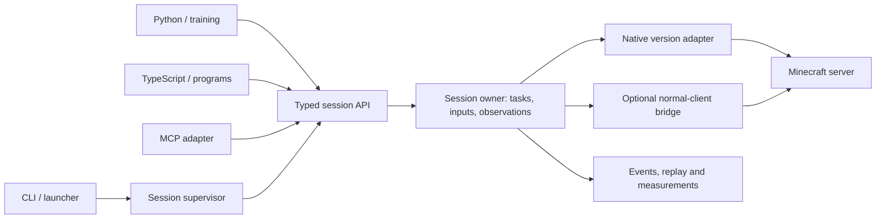

# Sawbyte — first full release plan

**Status: In development.** The release gates below remain open until the current candidate has complete, independent evidence. Earlier completion claims in `docs/REFLEXION.md` are historical and do not establish current release readiness.

This is the canonical engineering plan. It replaces the previous Phase 1–4 blueprint and its completion claims. The previous text is preserved verbatim in [the historical archive](docs/archive/PLAN-before-release-replan-2026-11-03.md); that archive is evidence of an earlier plan, not current instructions. [The new review](docs/REPLAN-REVIEW-2026-11-03.md) explains the findings, and [the baseline inventory](docs/REPLAN-BASELINE-2026-11-03.json) records every reviewed file and its hash. User instructions and [VISION](docs/VISION.md) govern the product goal.

This pass changes planning documents only. Implementation starts when the user asks to continue building. Thereafter, phases are dependency and verification boundaries, **not permission checkpoints**. Continue through them until the release criteria are met, or report a concrete external blocker. Do not announce a phase as the end of the job and wait for another “continue.”

## 1. The decision

Keep the independent Rust client and useful existing foundations. Rework the boundaries that currently allow the CLI, live client, workflows, SDKs and MCP to disagree about what an action means. A full rewrite would discard working protocol, scheduler and reference-test work; patching isolated command branches would preserve the underlying inconsistency.

The deliverable is a programmable Minecraft Java client that can run without graphics, with a usable launcher, a reusable engine, Python and TypeScript SDKs, optional normal-client integration, and credible correctness and resource measurements. It must support arbitrary user-authored combinations of player actions. A particular shop, task, server, neural-network reward or script format is never the architecture.

A first full release must demonstrate these properties together:

1. **Player-equivalent behavior.** Inputs pass through the supported version's timing, interaction, physics and inventory rules before network encoding. Direct mode changes optional input shaping, not legality or correctness.
2. **General automation.** Users can inspect available client state, react to events, compose actions, wait for outcomes, cancel, recover, and extend behavior without editing the engine for each new task.
3. **Faithful observations.** Preserve the information available to the client, including precision, item components and uncertainty. Do not fabricate missing state or silently truncate observations.
4. **Practical operation.** Download, launch, authenticate, configure, stop, reconnect, update and diagnose real sessions through both GUI and CLI.
5. **Measured efficiency.** Publish resource costs for demanding real-server workloads, including the SDK and launcher where used. Optimize without dropping mechanics or hiding stale data.
6. **Reproducible delivery.** Build, format, test, run Minecraft, package and benchmark exclusively through GitHub Actions. The user's laptop is for editing and review.

“100× better” is an ambition, not a release statistic. Earn preference through correctness, complete control, composability, reliable releases, useful diagnostics and measured efficiency. Do not copy Azalea's implementation or use another bot engine as Sawbyte's core. Mature general-purpose libraries are allowed.

## 2. Release contract and honest boundaries

### Versions and platforms

- Make **Minecraft Java 26.3** the primary full-support target. Mojang's official manifest identifies it as a release as of this review. Pin its actual artifacts, registry data and protocol identity in CI; do not infer packet correctness from the version's name.
- Complete a **26.2 adapter** before calling the version system finished. It must pass the same behavior contract, exposing genuinely version-specific differences. This proves that the architecture supports more than a renamed 26.3 profile.
- Later versions enter through generated data, reviewed behavioral changes and the complete compatibility suite. A launcher cannot automatically turn every Minecraft version into a working Sawbyte version merely by naming it `sawbyte-X`.
- Required first-release platforms: **Linux x86-64 and Windows x86-64**, including fresh-install launcher and client tests. Preserve existing macOS ARM64 build coverage; promote it to supported only after the same runtime, packaging and GUI checks pass. Mark preview platforms accurately and do not count compilation as runtime support.
- Native headless and normal-client bridge support have separate evidence rows. The native client must never require the bridge, a renderer or the Java client to operate.

### What “everything a player can do” means

Within a supported game version, every player-operable mechanic and client-visible interaction must have a programmable route. The acceptance inventory is derived from the reference client's input paths, screens and state handling, then checked against the server protocol. The category list below is a starting index, not the end of that inventory. Newly discovered missing operations remain release work.

Vanilla-compatible server plugins must be usable through generic screen, text, inventory, chat and interaction primitives. Server-specific labels, item IDs and success conditions belong in user programs or test fixtures. A plugin requiring an additional custom client protocol needs an explicit adapter; do not claim support by pretending its screen is a standard chest.

Native operation has real equivalents for lifecycle and settings. Graphical menu, focus and widget operations require the connected graphical backend. Preserve the normal client's appearance in that mode; do not develop a second renderer just to imitate it in headless mode.

The server does not reveal everything. “Exact observations” means preserving available values and reference-client semantics, with authoritative, predicted, stale and unknown states distinguished. It does not mean revealing unloaded chunks, secret plugin state, or hidden server calculations. Never present prediction as confirmed server truth.

### Full release means more than a prototype

No required mechanic may be removed from the release inventory merely because implementing it is difficult. A broken inventory decoder, missing mounted movement, unfinished normal-client control, unusable SDK or absent launcher is unfinished work. Explicit version, platform and custom-extension compatibility boundaries are legitimate; redefining incomplete vanilla behavior as out of scope is not.

## 3. Technical choices

| Area | Choice | Reason and constraint |
| --- | --- | --- |
| Native client and engine | Rust; independent gameplay implementation | Retains existing work, precise memory ownership, typed state and native deployment. No Java/Node/Python runtime in the headless core. |
| Tick execution | One owner of mutable state per session; deterministic tick stages | No competing transport handlers mutating the player. Independent sessions can run concurrently. |
| Network and service I/O | Tokio outside the deterministic simulation; bounded channels into the owner | Scales connections without an unbounded OS thread per controller; slow consumers cannot stall or exhaust the engine. Keep CPU-heavy planning off the I/O executor. |
| Serialization | `serde`/`serde_json` at control boundaries; typed messages inside the engine | Replace the incomplete custom JSON parser. Offline CI requires fetched, pinned dependencies, not a zero-dependency rule. |
| High-volume observations | Versioned MessagePack frames with typed binary array payloads | Preserve integer and float widths and support Python/TS efficiently. Benchmark against equivalent JSON before claiming a speedup. Avoid inventing another bespoke scalar format. |
| Transport | Framed, bounded local IPC over loopback TCP initially; request IDs, session IDs and subscriptions | Cross-platform and independently usable. Native Rust embedding bypasses serialization. Remote exposure requires explicit configuration, authentication and TLS. |
| User programming | Python and TypeScript SDKs; native Rust embedding | Users get ordinary language functions, loops, concurrency and libraries. No mandatory JSON workflow language or homegrown programming language. |
| Reusable automation | Typed asynchronous task handles and replaceable helper libraries | Navigation, crafting plans and screen workflows all use public primitives and report observable outcomes. |
| AI integration | MCP adapter over the same typed service | Standard discovery, schemas, lifecycle and cancellation; MCP is not a second gameplay engine or the training hot path. |
| Launcher GUI | Tauri 2 + TypeScript with a small UI layer; Rust supervisor | System webview for the launcher; keep it optional and separate from client memory costs. Start with plain TypeScript components unless UI complexity justifies a framework. |
| Normal-client integration | Thin Java/Fabric bridge for each supported version | A graphical backend and reference instrument, not Sawbyte's primary product. Consume the shared contract. |
| Training integration | Optional Gymnasium adapter and vector/session manager | Correct reset/step/termination semantics; task-specific observations and rewards remain replaceable. |
| Builds and evidence | GitHub Actions, pinned toolchains/dependencies and artifact hashes | All executable validation remains remote. One release gate owns publication. |

These are implementation decisions, not claims that the libraries are inherently fastest. Profile the resulting product. Revisit a choice only when a reproducible measurement or compatibility requirement justifies it; avoid repeated architecture churn.

Tauri uses a system webview and a Rust backend, which makes it a reasonable launcher choice but does not establish a RAM budget. [Tauri architecture](https://v2.tauri.app/concept/architecture/). Tokio documents bounded message-passing patterns suitable for the service boundary. [Tokio channels](https://tokio.rs/tokio/tutorial/channels). Cargo can fetch locked dependencies before later offline builds. [Cargo fetch](https://doc.rust-lang.org/cargo/commands/cargo-fetch.html).

## 4. One engine contract

The following names describe proposed responsibilities, not types that already exist.

### Actions, time and outcomes

Every request carries a request ID, session generation, owner, typed arguments and deadlines. Operations that depend on a screen, cursor, target or inventory state carry its expected revision. Specify whether timeout also cancels work. Repeating a non-idempotent request after a lost response must not silently perform it twice; reconnect reports the known result or an explicit uncertain outcome.

Use distinct lifecycle states: `accepted`, `running`, `applied`, `observed`, `confirmed`, `failed`, `cancelled`, `uncertain`. Not every operation needs every state. Define the completion condition per operation and its evidence source. Sending a packet is not proof of a mined block, moved item or completed purchase. A camera update may be locally applied without requiring a server acknowledgement that does not exist. A high-level program supplies its own success predicate when the server's business meaning is private.

Each live tick must have an explicit order:

1. Apply received authoritative changes and handle connection/lifecycle transitions.
2. Admit bounded control work and resolve ownership conflicts.
3. Advance tasks and input policies, rechecking execution-time prerequisites.
4. Simulate the player and interactions using the version rules.
5. Emit valid network messages and record applied actions.
6. Publish a coherent post-action observation and resolve eligible waits.

Document the exact tick numbering. A step for tick N resolves after its action was applied, not merely when a counter reaches N. Distinguish this local post-action result from later server confirmation. In a controlled test server, a server barrier can establish stricter synchronization; an ordinary multiplayer connection cannot promise lockstep server stepping.

Deadlines, disconnect detection and cancellation continue working while the player is dead, loading, stalled or not yet spawned. `idle` includes held inputs, camera shaping, pending events, mining, navigation and asynchronous tasks. A single shared pending-reply list must not block unrelated sessions or observers.

### Ownership and cancellation

Give movement, view and inventory interactions explicit ownership/composition rules. Looking while moving is valid; two independent inventory writers need arbitration. Observers never acquire control accidentally. Cancellation affects the caller's task tree or an explicitly requested session stop, not every other controller.

Cancel atomically: remove future task-owned work, release held inputs, issue required abort/cleanup actions through a path that cannot be cleared accidentally, then resolve waiters once. Recheck mining/tool/aim state each tick. Never leave a prescheduled finish behind after preemption. Test disconnect during a deferred reply, queue overflow and cancellation during server correction.

### State and observations

Maintain versioned, coherent snapshots with provenance, freshness, tick and sequence metadata. Keep server state and local prediction separate and reconcile them. Subscribe to fields/regions/events or request complete snapshots; caller-selected subsets are explicit, not silent decoder truncation.

Represent unknown/unloaded world state distinctly from air or a solid placeholder. Invalid data cannot authorize an action. Bounded caches must use explicit eviction and knowledge invalidation. Exact full observations may be paginated or streamed under one consistent snapshot revision. A capacity failure reports itself rather than dropping entities or item data invisibly.

### Extensions and libraries

External programs can implement novel tasks using the public contract. Helpers for pathfinding, inventory transfers, crafting, combat policy and screen traversal are replaceable. Expose predicates, subscriptions, asynchronous waits, task groups, cancellation and structured errors, rather than requiring a custom built-in command for each goal.

Do not expose an ordinary “send any packet” escape hatch that bypasses player rules. Custom protocol support belongs in a declared version/backend extension with its own tests. Trusted experimental extensions may be clearly separated from the supported player-equivalent contract.

## 5. Coverage inventory required for release

Create a machine-readable ledger in implementation. Each entry records: mechanic, version, backend, required observations, callable primitive, relevant input/timing rules, success/failure criteria, oracle, automated scenarios, evidence commit and remaining gap. Use separate states for designed, implemented, connected, scenario-verified and broadly validated. A function declaration cannot advance all five states.

| Family | Required coverage and combinations |
| --- | --- |
| Connection and lifecycle | Authentication, configuration, registries/tags, initial spawn, keepalive, compression/encryption, disconnect, reconnect, server transfer, reconfiguration, death/respawn, dimension change, teleport acknowledgement, resource-pack negotiation and client settings. |
| Ground and aerial movement | Walking, sprinting, sneaking, jumping, stepping, slopes/shapes, collision, knockback, ladders/vines, swimming/diving/crawling, fluids, friction, effects/attributes, gliding, creative flight and spectator behavior. |
| Vehicles and mounts | Enter/exit, riding controls, steering, jumping where applicable, passenger state, vehicle corrections and inventory interactions. |
| Block interaction | Reach and line of sight, correct target face/hit position, use/hold/release, mining progress/tool/environment effects, abort, placement/orientation, secondary use, cooldowns and server correction. |
| Entity interaction | Correct type/pose-dependent bounds, targeting, attack timing, interaction point/hand, held-item use, equipment, projectiles and observed outcomes. |
| Inventory and equipment | Full component data/defaults/removals, inventory/container mappings, cursor, hotbar/offhand/armor, every click mode/button/drag sequence, swap/drop/pick, stacking, rejection and reconciliation. |
| Screens and text | All standard container types and their actions; recipes/crafting, furnace-like processing, trading, anvil, enchanting, brewing, beacon, stonecutter, smithing, loom, grindstone and other supported-version screens; signs, books, text selection/editing, dialogs, focus and confirm/cancel behavior. Derive the final list from the reference version. |
| Communication and visible UI state | Chat, command input/suggestions, signing/session rules where required, titles/action bars, player list, teams/scoreboards, boss bars and server-visible settings. Preserve text components, Unicode and structured item names/lore. |
| World and entity knowledge | Chunk updates/unloads, state-dependent shapes, fluids, block entities, dimensions, borders, time/weather, relevant light/biome/registry data, entity lifecycle/metadata/rotation/velocity/equipment/effects and cross-field consistency. |
| Creative/admin-available player actions | Creative inventory/pick behavior, permitted commands and game-mode-specific controls with the same server permissions as a normal client. Do not grant additional permissions. |
| Graphical client controls | Normal-client launch and attach, screen/widget inspection, menu/settings/input/focus control, input ownership and release on detach. Native settings have explicit headless equivalents. |
| Automation lifecycle | Event waits, conditions, loops/functions in SDK code, concurrent tasks, per-task deadlines, retries only when safe, cancellation, recovery, replay, multi-controller ownership and custom extensions. |
| Training and scaling | Real action windows, coherent observations, resets on controlled servers, episode boundaries, replaceable rewards, deterministic policy seeds, multiple environments and per-session resource limits. |

Extend this list when reference inspection reveals another player-operable path. Also test **cross-family interactions**: inventory changes during mining, GUI opening while moving, death during a wait, dimension change during navigation, slow observers during a swarm, and cancellation during a held action. Passing isolated rows does not prove composition.

## 6. Execution order and completion gates

All gates below are currently **open**. Historical green CI is evidence for its exact older source tree, not completion of these gates. Build in substantial coherent batches, with earlier validation infrastructure reused throughout. Documentation and measured performance advance alongside implementation.

### Phase 0 — Establish a trustworthy source and CI baseline

**Existing areas:** both workflows, manifests/locks, `native/src/lib.rs`, native/core tests, SDK tests, documentation.

- Preserve and review the current dirty work; do not reset or overwrite it wholesale. Turn the reviewed state into an identifiable CI candidate when implementation is authorized.
- Fix source-level compilation blockers: duplicate `tokenize_command_line` import; nonexistent `Player::box_aabb`; nonexistent `Tx::new`/`Rx::new`; tests accessing private palette fields. Resolve all other errors revealed by actual Rust compilation.
- Correct contradictory tests and weak assertions without deleting intended behavior. Cover humanised camera timing, ordered scheduling, mining aim, real `gym.step` arguments, packet/profile identity and parsed JSON responses.
- Run the actual root and native suites, clippy and formatting checks in Actions. Fetch dependencies first, then use committed locks; generated locks/format patches must be reviewed and committed, not silently change the tested tree.
- Add TypeScript compilation and package-consumer tests, Python package installation tests and bridge checks. Test built packages, not an independent handwritten `index.js`.
- Fix Windows shell selection, require every promised packaged binary, and stop manual CI runs from automatically overwriting a release.
- Create a single source/evidence register. Reconcile all 55 historical audit entries against the current tree and the new review; retain fixed-item evidence rather than assuming old findings remain unchanged.
- Establish a basic real-server runner, raw trace format, process-tree resource sampler and artifact manifest now. Run a preliminary benchmark as soon as this baseline can join a server; label incomplete workloads honestly.

**Gate G0:** required checks pass on the exact candidate commit on Linux and Windows; macOS build coverage retained. All failures have been resolved or are explicit open release blockers. There is no “fully verified” claim based only on static review, Python or grep.

### Phase 1 — Consolidate the engine and public contract

**Existing areas:** core scheduler/events/tasks/MCP, native session and control listener, protocol crate, both SDKs.

- Separate responsibilities behind typed interfaces: session state, tick execution, version protocol, task executor, observation store, transport service and supervision. Split the large native library incrementally after contracts and characterization tests exist.
- Introduce session/request/task IDs, ownership, status transitions, revision checks, bounded admission, wall-clock and tick deadlines, and structured results/errors.
- Replace duplicate special command paths with adapters into the same dispatcher. Preserve useful text commands as convenience clients; they must not implement different wait semantics.
- Fix tick ordering and step completion. Add bounded action durations and well-defined release behavior. Remove global script blocking and define fair per-tick request budgets.
- Implement atomic task cancellation and disconnect ownership. Ensure an abort cannot disappear when queues are cleared and old finish events cannot survive cancellation.
- Replace the custom JSON parser and unsafe newline/string rewriting. Specify frame length, maximum nesting/payload sizes, IDs, authentication, backpressure and shutdown. Preserve full Unicode and integer IDs.
- Make native embedding real: construct, start, observe, submit, await, cancel and close through a supported library interface with private mutable internals.

**Gate G1:** the same scenario through CLI, TCP, Python, TypeScript, MCP and Rust embedding produces equivalent action/event traces. Concurrent writers, slow readers, overflow, lost replies, stale requests and disconnects cannot create false success, stuck inputs or cross-owner cancellation.

### Phase 2 — Complete version data, decoding and session state

**Existing areas:** native wire/world/inventory/player/auth/session, `tools/player_lab.py`, version manifests and bridge data extraction.

- Generate complete version-specific registries, item component schemas, packet mappings, recipes/tags and behavioral data in CI from pinned authoritative version artifacts/reference instrumentation. Record source hashes and extraction tooling.
- Replace the two-block built-in profile and substring-based shape/hardness guesses. Static registry reports alone may be insufficient for context-dependent collision/interaction shapes; encode those rules and compare their results against the reference client.
- Package usable profiles with the product. A missing user-specified profile is an explicit error; never silently fall back to a two-state world.
- Decode complete packet structures with bounded lengths and exhaustive cursor accounting. Unknown components cannot desynchronize later slots. Preserve the full component patch and resolved semantics; handle removed/default values.
- Update containers and inventory atomically. Correct cursor state, window/player slot mapping, state IDs and revisions. Mark unknown state explicitly if decoding cannot complete.
- Complete entity metadata, dimensions, poses, velocities, rotations, equipment and effects. Replace silent entity eviction and NBT truncation with explicit capacity and observation semantics.
- Implement complete login/configuration/play/reconfiguration/death/respawn/dimension/transfer state transitions. Parse the transition payload rather than resetting health/dimension values to constants.
- Implement current online authentication lifecycle, refresh and revocation handling. Separate credentials from ordinary instance settings and redact logs.
- Add the 26.2 adapter using the same generated-data contract. Record differences; never copy a packet table and change the label.

**Gate G2:** version identity is independently checked. Decoder corpus, malformed-input fuzzing, registry coverage and real-server state comparisons pass for both versions. No unknown state silently becomes air, a unit cube, an empty slot or an invented success.

### Phase 3 — Finish player mechanics and generic interactions

**Existing areas:** player physics, raycasting, world shapes, task execution and event encoding.

- Build the complete player-operation inventory from the reference client, then implement every required row.
- Expand parity beyond a flat movement tape: fluid and pose transitions, state-dependent collisions, attributes/effects, knockback, mounts, gliding, flight/spectator, and interaction timing.
- Use the target version's formulas, numeric precision and operation order. Establish per-field comparison tolerances from reference behavior; record exact matches where supported rather than promising universal bit equality without evidence.
- Make held attack/use buttons invoke the same gameplay logic as direct interaction helpers. Revalidate reach, aim, collision, cooldown, inventory and target state at execution time.
- Make mining a live state machine. Tool/environment/target changes alter progress or cancel it. Confirm completion from appropriate world/inventory observations; sending the finish packet is only an intermediate state.
- Complete placement, entity interaction, item use/charge/release, hand swapping, creative operations, mounts and every inventory click/drag sequence.
- Implement coherent local inventory prediction and authoritative reconciliation. Reject stale screen operations before acting; do not remove local screens merely because queue submission was attempted.
- Implement generic text, dialogs, screen controls and navigation. Map each screen's actual protocol; do not encode every field as an anvil rename or every widget as one generic button.

**Gate G3:** all required mechanic rows have connected APIs and reference/server-backed tests. Illegal or stale actions fail clearly. Independent server state proves effects. Unknown packet encodings become typed failures, never success-shaped log lines.

### Phase 4 — Make arbitrary automation pleasant and reliable

**Existing areas:** tasks, navigation, screen selectors, humanisation, SDKs, MCP, CLI.

- Build asynchronous helpers on public primitives: inspect/select, observe-and-wait, task groups, bounded retries, transfers, recipes, navigation and interaction sequences. Avoid embedding server business logic.
- Upgrade navigation to incremental planning over known geometry with collision-aware movement, replanning, hazards, stuck detection, budgets and cancellation. World changes invalidate affected paths. Expensive search must not stall the player tick.
- Make humanisation default and configurable: camera/input timing, click and typing policies, deterministic seeds and replaceable user policies. Validate ranges and ensure jitter cannot exceed declared limits. Direct mode remains exact and rule-correct. Do not promise indistinguishability or anti-cheat immunity.
- Ship Python and TypeScript packages with matching typed APIs, full Unicode-safe structured arguments, request correlation, timeouts, subscriptions and deterministic cleanup. Eliminate the `.eval` mismatch and TS/JS divergence.
- Finish MCP initialization/negotiation, notifications, errors, discovery, typed tool schemas, cancellation and resources where advertised. Generate adapters/schemas from the shared API where practical. Conformance follows a pinned MCP specification version.
- Provide runnable examples spanning different domains: exploration/building, inventory organization/crafting, entity interaction, arbitrary server menus, coordinated sessions and training. Each example must run from the distributed package.
- Create held-out scenarios with changing labels, slot order, quantities, screen sequences and delays. These must be implementable solely in user code without new engine commands.
- Add replayable action/event traces, structured diagnostics, task inspection and explainable failures: what was requested, what was observed and why an action did not complete.

**Gate G4:** a new multi-step task can be written in SDK code without an engine edit. Equivalent SDK/MCP behavior is tested against real sessions. No hidden script bypass, fixed shop sequence, fixed reward or fabricated workflow transition is needed.

### Phase 5 — Deliver the launcher and normal-client experience

**Existing areas:** core launcher, CLI, packaging, branding, auth and bridge. **New areas:** GUI, process supervisor, installers/updater and backend manifests.

- Implement a supervisor with atomic instance ownership, safe persistent settings, schema migrations, process handles, readiness handshake, unique control endpoints, exit reasons and restart policy.
- Correct lock races, unsafe/ambiguous instance records and lock cleanup after launch failure. Backups and rollback must restore real state without overwriting a running instance.
- Build the GUI: account management, version/backend selection, instances, launch/stop/restart, script attach/run/cancel, session status, logs, settings, resource usage, diagnostics and updates. Keep implementation jargon out of ordinary user flows.
- Support offline test identities and legitimate Microsoft account login. Store refresh/access credentials in appropriate OS-backed secure storage; never bundle accounts or hardcode tokens.
- Provision required binaries, version profiles and, for normal-client mode, the legitimate game/runtime/bridge dependencies with integrity checks, resumable downloads, cache reuse and offline launch after successful provisioning.
- Keep GUI and headless sessions separable. Closing the launcher follows an explicit user setting and cannot accidentally kill or orphan sessions. GUI dependencies are not loaded by the headless executable.
- Complete the normal-client bridge: continuous shared API, all required inputs and screen interactions, observations, cancellation, lifecycle and ownership. Replace racing command files and swallowed errors. Verify the bridge's button set matches the core.
- Use `assets/sawbyte.png` in app icons, installers, window/taskbar branding and the README. Preserve the original supplied image.
- Package Linux portable/archive plus a supported desktop installation route, and Windows installer plus portable archive. Test spaces/non-ASCII paths, a clean user account, first launch, uninstall and update rollback. Include prerequisite detection for the system webview.

**Gate G5:** a clean Linux or Windows machine can download an artifact, set up an account/server, run either backend, attach an SDK program, inspect its result and stop/update safely. Packaging must not depend on files in a developer checkout. An unattended scripted smoke test and a recorded GUI walkthrough cover both platforms.

### Phase 6 — Complete training and multi-session operation

**Existing areas:** observation API, Python environment wrapper, supervisor and session manager.

- Implement action windows and coherent post-action observations through the engine contract, including buttons, view, hotbar and discrete actions. Distinguish local ticks from server synchronization.
- Implement real `reset` using a declared controlled-server reset provider. An ordinary public server may not allow world reset; report that capability explicitly rather than clearing a Python counter and pretending it reset Minecraft.
- Define Gymnasium action/observation spaces, seeding, `terminated` versus `truncated`, `info` and resource cleanup. Rewards and observation transforms are user-supplied wrappers. Run the environment checker. [Gymnasium Env contract](https://gymnasium.farama.org/api/env/).
- Offer lossless structured observations plus efficient typed arrays for selected regions. Preserve array ownership across steps; do not mutate a previously returned observation underneath a learner.
- Support vectorized environments, session creation/attachment, readiness, coordinated starts, bounded concurrency and per-session resource budgets. Share immutable version data where useful, never mutable player state between accounts.
- Support trace capture/replay and deterministic policy seeds. Document that a live multiplayer server's external players/timing are not made deterministic by setting a seed.
- Run a real small learning/inference integration and high-rate random-action stress workload; neither replaces broad gameplay tests. Verify one session's crash, stalled SDK or slow observer does not corrupt the rest.

**Gate G6:** package users can step/reset controlled environments and coordinate multiple clients with correct results and bounded resources. `spawnSwarm` or similar APIs cannot be advertised before they reach a real supervisor implementation.

### Phase 7 — Optimize and prove behavior under load

Start instrumentation in G0 and run smaller versions of these workloads throughout development. This phase completes the full measurements once mechanics are present.

- Profile CPU time, allocations, retained memory, network traffic and observation serialization under actual gameplay.
- Optimize measured hot spots: chunk palettes/storage and eviction, allocation reuse, shape/raycast queries, interest-filtered snapshots/deltas, navigation budgets and shared immutable registries. Preserve all required semantics and trace evidence.
- Keep compression, batching, cache sizes and observation frequency configurable within safe bounds. Backpressure must be visible; performance must not depend on silently dropping required actions or state.
- Repeat correctness suites after changes to physics, codecs, storage or scheduling. Remove the old instruction to freeze physics after one successful tape.
- Run the benchmark matrix and fault/soak checks below on the exact release candidate. Publish raw measurements and scope, not just an attractive number in a badge.

**Gate G7:** demanding workloads remain correct, stable and within the preregistered budgets. No unexplained memory growth, action-loss, stale-success, tick starvation or corruption remains. Comparisons use matched workloads and disclose unsupported comparisons.

### Phase 8 — Package, rehearse and prepare the full release

- Consolidate release orchestration so all required build, correctness, SDK, launcher, bridge and benchmark jobs refer to the same commit and version manifest.
- Require gates G0–G7. All first-release ledger rows need evidence; open required rows block release. No late scope reduction to turn red checks green.
- Align application/SDK/bridge versioning and document compatibility. Produce installers, portable binaries, SDK packages, checksums, provenance/dependency manifests, licenses, release notes and evidence index.
- Separate CI preview artifacts, release candidates and stable publication. Manual workflow dispatch must not overwrite a hardcoded stable tag. Publication is one gated job; partial releases and competing uploads are not acceptable.
- Protect updates with authenticated manifests, artifact verification, atomic replacement and rollback. Arrange signing credentials where required and report any external prerequisite early.
- Run clean-install and upgrade rehearsals using the actual candidate downloads. Run every README quick-start example against those downloads.
- Rewrite README, coverage, handoff, player instructions and decisions to match verified behavior. Put the supplied icon at the top and make the page clear and attractive without hiding limitations or presenting old fixture statistics as current results.
- Produce a final evidence report: supported versions/backends/platforms; capability coverage; correctness results; resource distributions; known non-blocking issues; artifact hashes and exact source commit.

**Gate G8:** every release checkbox in section 9 is satisfied and the complete release candidate is ready. Preparing it does not itself authorize publishing a stable release to users; publication follows the user's release instruction or previously explicit release authorization.

## 7. Verification strategy: independent evidence

Use four distinct layers:

1. **Focused tests and properties:** parsers, shapes, scheduling, revision checks, numeric edges, cancellation and ownership. Include malformed/truncated inputs, Unicode, large identifiers and boundary sizes.
2. **Reference comparisons:** run the real normal client through recorded inputs; compare position/velocity/pose, collision, selected target, input timing, inventory/cursor and screen state. Replays use pinned worlds and versions. Do not derive expected values from the implementation under test.
3. **Live server assertions:** observe actual block/entity/inventory outcomes from an independent test observer or controlled server interface. Test instrumentation may inspect/reset state; the tested gameplay must still use ordinary player inputs. Include a vanilla server and a representative plugin server with vanilla-compatible interfaces.
4. **Distributed-product tests:** download the candidate, install SDKs, run launcher/bridge/native workflows and varied programs as a new user would. No imports from an unbuilt source checkout.

The existing 160-tick movement comparison is retained as one regression case. Add diverse terrain and mechanics; use randomized and held-out composed scenarios to catch overfitting. Fuzz codecs and state transitions with bounded resource use. Mutate known conditions to show tests fail when an action is dropped, confirmation is forged or cancellation is lost.

Every result records source SHA, dependency/profile hashes, game/server versions, backend, runner/hardware, scenario version/seed, settings, duration and logs. Preserve failures as artifacts. Failed required tests stay visible until fixed; do not skip them, weaken their assertions or substitute screenshots of green job headings.

Ordinary actions without a dedicated server acknowledgement require a carefully defined observed outcome or uncertainty. The test oracle must not claim server confirmation merely because Sawbyte emitted an event named `complete`.

## 8. Benchmark design

### Workloads

Run both direct and default-humanised modes where timing changes the workload. Report server load separately so a saturated server is not mistaken for client efficiency.

| Workload | Exercise | What must be verified alongside resource measurements |
| --- | --- | --- |
| Connected idle | Real chunks, entities, keepalive, subscriptions on/off | Session remains healthy; cache and log growth stabilize. |
| Ordinary survival | Exploration, inventory, crafting, food/tool use and interactions | Same useful actions and outcomes as the reference run. |
| Terrain and chunk churn | Long travel, changing view distance, dimensions, repeated unload/reload | Correct collision, bounded retained chunks, no stale world reuse. |
| Busy entities and updates | Dense entity areas, movement/metadata/equipment updates | No silent eviction, stale bounds, lost critical state or tick starvation. |
| Inventory and screen pressure | Large full-component items, many screen transitions, drag/click/text operations and delayed responses | No component truncation, slot/cursor desync, false confirmation or wrong-screen actions. |
| Sustained interactions | Mining/placement/crafting, combat/use actions, tool and effect changes | Rule-correct timing and server-observed effects throughout. |
| Heavy automation | Frequent replanning, concurrent tasks, rapid observations and cancellation | Fair scheduling; correct outcomes; bounded queues. |
| Training | High-rate typed observations, controlled resets and vector environments | Correct step boundaries, observation ownership and episode semantics. |
| Multiple sessions | 1, 10, 50 and 100 clients where server/runner capacity allows | Report achieved scale and bottleneck; do not silently reduce work per client. |
| Graphical integration | Normal client plus bridge, launcher open/closed | Full process-tree cost and functional parity, separately from native headless. |
| Faults and soak | Latency, jitter, fragmented traffic, disconnect/reconnect, death/respawn, slow consumers, repeated session churn | No leaked processes, stuck inputs, invalid retries or unbounded memory growth. |

These are workloads, not user-facing features such as a built-in shop. Each long test mixes mechanics and checks useful work rather than idling for a long duration.

### Measurements and fairness

- Record client-only and whole-stack resource costs separately: native process, SDK/controller, supervisor, launcher/webview and graphical client when used. Report server/observer costs separately rather than hiding them or adding them inconsistently.
- Measure cold/warm startup, download/install size, steady/peak memory, allocation rate, CPU time, p50/p95/p99 tick and API latency, missed deadlines, network bytes, completed actions per second, corrections/disconnects and recovery time. Measure energy only where the runner provides valid measurements.
- On Linux include RSS and PSS where available; on Windows include working set and private committed memory. Name each metric. Do not compare unlike measurements as “RAM.”
- Use identical version, server/world, route/task, view/simulation distance, observation payload, timing mode and completed work. A client that failed to load the world is not the fastest client.
- Warm up, then measure at least five repetitions for representative workloads; publish distributions and runner variance. Use a fixed remote reference runner for firm cross-release performance claims; shared hosted runners provide trend evidence with noise disclosed.
- Compare against the normal client, and Mineflayer/Azalea only where both actually support the same version and scenario. Record competitor version/commit and documented settings. Unsupported cases are “not comparable,” not automatic wins. No competitor engine is incorporated into Sawbyte.
- SBIF encode/decode versus JSON formatting alone is not an end-to-end comparison. Codec comparisons include equivalent fields, precision, encode, transport, decode and allocation costs.

### Budgets and duration

The user's 100 MB example is a direction, not an already agreed universal limit. Establish the first representative measurements in G0–G3, then commit a named workload/hardware budget before optimizing. Publish the baseline and target; do not move it after seeing a failed candidate.

Initial mandatory performance gates:

- Sustain the server's expected tick cadence under each declared supported load, with measured headroom. No unbounded backlog or lost required actions; report p99 and missed deadlines against the normal 50 ms client tick interval.
- No unexplained growing retained memory after warm-up and repeated equal-work cycles. Validate cleanup after session churn.
- Detect regressions exceeding 10% in median steady memory or CPU/work on the fixed reference runner; require investigation and an explicit recorded tradeoff, never automatic acceptance. Use uncertainty and repeated runs to distinguish noise.
- Require a minimum **two-hour mixed-workload soak on Linux and Windows**, plus a **long-run soak of at least six hours on the fixed remote CI runner** before stable release. Configure suitable runner/time limits; do not assume one hosted job can run indefinitely.
- Run the scale ladder until the requested target or a documented measured hardware/server limit. A crash, silent omission or desync is not an acceptable capacity boundary.

Absolute memory/CPU budgets are a G0–G3 deliverable because today's tiny fixture cannot justify them. G7 cannot pass until those budgets exist and are met. If the agreed target proves infeasible, report the measured tradeoff; do not weaken correctness to manufacture the number.

All server runs and measurements execute from GitHub Actions. A fixed self-hosted runner, if needed, means a remote benchmark machine attached to Actions, never the user's laptop. Provisioning paid resources or using real account credentials requires existing authorization; identify those prerequisites early and continue independent work while they are unavailable.

## 9. Release checklist

- [ ] Exact candidate source and all generated data are identified and reproducible.
- [ ] Rust root/native, Python, TypeScript, bridge, launcher and packaging checks pass remotely.
- [ ] 26.3 and 26.2 profiles/adapters are complete and separately verified.
- [ ] All required player-operation ledger rows are implemented, connected and independently verified; composed scenarios pass.
- [ ] Generic automation works through all advertised interfaces with consistent lifecycle semantics.
- [ ] No fabricated results, silent decoder truncation, unsupported encoding success or hidden stale observations remain.
- [ ] Default humanisation, direct mode and custom policies obey the same game rules.
- [ ] Authentication, session lifecycle, recovery, cancellation and ownership pass failure tests.
- [ ] Native embedding, Python/TS packages, MCP, training and multi-session examples work from release artifacts.
- [ ] Launcher and optional normal-client integration pass fresh-install and upgrade rehearsals on Linux and Windows.
- [ ] Workload budgets are committed, met and accompanied by real-server heavy-load and soak results.
- [ ] Every historical/new audit finding is resolved with evidence or explicitly classified as a non-blocking issue with rationale; required behavior cannot be reclassified away.
- [ ] Unified release gating, artifact integrity, updater/rollback and version compatibility are verified.
- [ ] README/docs match the exact evidence; supplied branding is present.
- [ ] External prerequisites and any residual limits are disclosed in the final release report.

## 10. Continuous execution after authorization

For each coherent work batch: implement the dependency-ready work; add meaningful outcome tests; push the authorized candidate to GitHub; monitor the relevant Actions jobs; inspect failures and artifacts; fix failures; update the coverage/evidence register; continue automatically to the next open gate.

Use phases to organize dependencies, not to ration work. Avoid both five-item artificial stopping points and a huge untested code dump. Keep a short durable handoff containing the current commit, dirty work, open gates, active CI runs and next executable tasks so work resumes correctly after network/context/usage interruptions.

Only pause dependent work for an actual missing external prerequisite, an irreversible action without authorization, or an execution limit. Do not ask the user to approve ordinary implementation choices or the next phase. State exactly what is blocked and keep making independent progress where possible.

Do not claim completion because a time window ended, a plan was written, a benchmark binary ran or one workflow turned green. Completion is G8 with the evidence above.

## Reference points

- [Official Minecraft version manifest](https://piston-meta.mojang.com/mc/game/version_manifest_v2.json), inspected 2026-11-03: 26.3 release; 26.2 also a released version. Protocol details still require pinned extraction and validation.
- [MCP tool specification](https://modelcontextprotocol.io/specification/2025-11-25/server/tools): schemas and discovery are part of the adapter contract; pin the supported protocol version explicitly.
- [Mineflayer upstream](https://github.com/PrismarineJS/mineflayer) and [Azalea upstream](https://github.com/azalea-rs/azalea): comparison candidates and ecosystem context, not implementations to copy or unmeasured performance claims.
- [Historical build workflow](https://github.com/5ivesaw/Sawbyte/actions/runs/41599715203) and [historical player workflow](https://github.com/5ivesaw/Sawbyte/actions/runs/41599715328): both succeeded for `aa7053b`; neither validates the uncommitted changes reviewed here.
