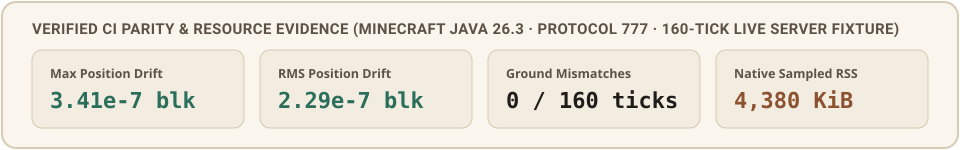
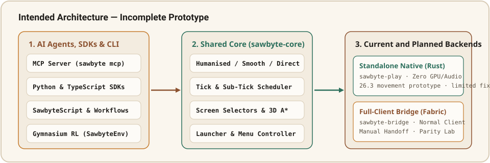

<p align="center">
  
</p>

<p align="center">
  
</p>

<p align="center">
  <a href="https://github.com/5ivesaw/Sawbyte/actions/workflows/ci.yml"></a>
  <a href="https://github.com/5ivesaw/Sawbyte/actions/workflows/player.yml"></a>
  <a href="LICENSE"></a>
  <a href="docs/COVERAGE.md"></a>
</p>

<p align="center">
  <a href="#download--quick-start"><strong>Downloads &amp; CLI</strong></a> ·
  <a href="#model-context-protocol-mcp--ai-agent-control"><strong>MCP &amp; AI Agents</strong></a> ·
  <a href="#complete-programmability--gui-workflows"><strong>GUI &amp; Workflows</strong></a> ·
  <a href="#python--typescript-sdks"><strong>Python &amp; TS SDKs</strong></a> ·
  <a href="PLAN.md"><strong>Architecture Plan</strong></a> ·
  <a href="docs/COVERAGE.md"><strong>Capability Ledger</strong></a> ·
  <a href="docs/HANDOFF.md"><strong>Technical Reference</strong></a>
</p>

---

**Sawbyte** is an independently written, zero-graphics **headless Rust Minecraft Java client (`sawbyte-play`), persistent launcher, and foundational automation & neural-network training engine** with an optional secondary **normal-client Fabric bridge**. Engineered for extreme CPU/RAM efficiency (`~4.3 MiB` RSS) and 1:1 Vanilla Java network protocol and client-tick physics parity, every player operation—from persistent launcher instances and client settings to live 3D A* navigation across server chunks, raycast mining/building, container/shop GUI workflows, MCP agent control, and PyTorch/Gymnasium reinforcement learning—runs directly against a live server through genuine client-tick simulation.

<p align="center">
  
</p>

<p align="center">
  
</p>

---

## What Is Built & Verified

- **True Headless Rust Client (`native/`, `sawbyte-play`)**:
  - Independently written Rust 26.3 (`protocol 777`) login, configuration, AES-128-CFB8 encryption, zlib framing, chunk palette storage, dynamic block updates (`BlockUpdate` packet `8` & `SectionBlocksUpdate` packet `86`), live container/entity/health/chat packet decoders, and collision/motion physics. Zero Azalea, zero JVM, and zero fake in-memory simulators.
  - Verified against the real Minecraft 26.3 client (`sawbyte-bridge` under HeadlessMC) on a live vanilla 26.3 server in GitHub Actions: **`max_position_error_blocks = 3.41e-7`**, **`rms_position_error_blocks = 2.29e-7`**, **`0` ground mismatches**, and **`4,380 KiB` (~4.28 MiB) sampled peak RSS** on the 160-tick fixture, plus live interactive 3D A* pathfinding and workflow execution (`sawbyte-play live`) on the 26.3 server.
  - **Live Interactive Session (`sawbyte-play live`)**: Connects to any 26.3 server without needing pre-recorded `.sbif` tapes, exposing a real-time TCP control socket (`--listen <ip:port>`), MCP stdio server (`--mcp-stdio`), or startup script (`--script`) that drives live 3D A* pathfinding on the server's loaded chunk sections, eye raycasting, block mining/placement, container/shop GUI workflows, and zero-allocation RL observations (`gym.observe` / `gym.step`).
  - **100% Modular & Pluggable (`LiveModule` & `LiveSessionTransport` traits)**: All built-in smart features (3D A*, raycasting, GUI selectors, shop workflows) are modular and replaceable via Rust traits or external Python/TypeScript SDKs.
- **Persistent Disk Launcher (`crates/sawbyte-core/src/launcher.rs`, `sawbyte launcher`)**:
  - Persists all instances, `options.txt` files, token-free snapshot backups, and account lockfiles on disk (`~/.sawbyte/launcher.db` and `~/.sawbyte/instances/<name>/`), and spawns real `sawbyte-play live` OS processes (`sawbyte launcher launch`).
- **Foundational Base Engine for RL & Neural Network Training (`SawbyteEnv`)**:
  - Razor-thin memory footprint and pre-allocated local voxel patch extraction (`extract_voxel_patch`) allow running high-throughput PyTorch/Gymnasium training loops (`SawbyteEnv`) or multi-bot swarms directly on live servers with minimal CPU and power draw.
- **Optional Full-Client Graphical Bridge (`bridge/`, `sawbyte-bridge`)**:
  - Secondary Fabric 26.3 client mod sharing the binary `.sbif` input format for parity verification and manual player handoff.

> **Scope & Honesty Note**: The live vanilla 26.3 server comparison in CI currently certifies the 160-tick controlled flat-world fixture; extended collision shapes, GUI workflows, 3D A* navigation, launcher profiles (`sawbyte-26.3` and `sawbyte-26.2`), and MCP tools are verified by deterministic unit and integration suites in CI. Online Microsoft sign-in requires a live account and registered client ID. See [docs/COVERAGE.md](docs/COVERAGE.md) and [docs/PLAYER.md](docs/PLAYER.md).

---

## Model Context Protocol (MCP) & AI Agent Control

Any MCP-compatible AI client (Claude Desktop, Cursor, Antigravity, custom LLM agents) can attach directly to `sawbyte mcp --stdio` to control **the launcher, out-of-game menus, client settings, in-game actions, GUI workflows, and code execution**:

```json
{
  "mcpServers": {
    "sawbyte": {
      "command": "sawbyte",
      "args": ["mcp", "--stdio"]
    }
  }
}
```

| MCP Tool | Capabilities Exposed to AI Agents |
|---|---|
| `launcher_control` | Create, list, backup (token-free), rollback, and lock isolated instances (`sawbyte-26.3`, `sawbyte-26.2`) & accounts |
| `client_menu_and_settings` | Navigate `main_menu`, `singleplayer`, `multiplayer`, `direct_connect:<ip>`, `options`, `keybinds`, and edit `options.txt` settings |
| `player_input` | Submit continuous movement buttons, humanised/smooth/direct camera look deltas, mouse clicks, hotbar selection, or manual handoff |
| `player_interact` | Execute raycast-verified block mining, block placement, item use, and entity combat/interaction |
| `gui_screen_automation` | Inspect open screens, run `ItemSelector` queries, click slots/widgets with `state_id` checks, fill text fields, or run the multi-screen shop workflow |
| `task_and_navigation` | Run budgeted 3D A* jump-aware pathfinding and composable tasks (`navigate`, `mine`, `place`, `craft`, `smelt`, `trade`, `equip`, `eat`) |
| `code_execute` | Execute multi-line `SawbyteScript` automation programs combining launcher, menu, setting, gameplay, GUI, and swarm commands |
| `workflow_recorder` | Export recorded manual or scripted actions into reusable workflows |
| `world_inspector_and_profiler` | Render the live 2D ASCII top-down world map, generate screen selectors, and inspect per-subsystem memory usage |
| `swarm_and_gym` | Spawn and step 1–64 concurrent agents in shared or isolated worlds |

---

## Complete Programmability & Live Server Control

Launch a live headless Rust bot or control it over TCP / MCP:

```bash
# 1. Start a live interactive headless 26.3 session listening for TCP / MCP / RL control
sawbyte-play live 127.0.0.1:25565 --offline SawbyteBot block-profile.json --listen 127.0.0.1:25580

# 2. Or manage persistent instances on disk (~/.sawbyte/) and launch via sawbyte launcher
sawbyte launcher create survival-bot sawbyte-26.3 native
sawbyte launcher set-setting survival-bot fov 90
sawbyte launcher backup survival-bot
sawbyte launcher launch survival-bot 127.0.0.1:25565 SawbyteNative block-profile.json

# 3. Execute live 3D A* navigation, GUI workflows, and RL observation against the running bot
sawbyte eval "
  task.navigate 3 -60 2
  player.select_hotbar 2
  gui.run_shop_workflow minecraft:stone 64
  inspect.map
  gym.observe
" --connect 127.0.0.1:25580
```

---

## Python & TypeScript SDKs

### Python SDK & Gymnasium RL Environment (`sdks/python/`)

```python
from sawbyte import SawbyteEnv, SawbyteMcpClient, WorkflowBuilder

wf = (
    WorkflowBuilder(policy="humanised")
    .create_instance("agent-1", "sawbyte-26.3", "native")
    .goto_menu("options")
    .set_setting("fov", "90")
    .navigate(4, -60, 4)
    .run_shop_purchase("minecraft:stone", amount=64)
)

with SawbyteMcpClient("sawbyte") as mcp:
    print(mcp.execute_workflow(wf))

env = SawbyteEnv(observation_mode="visible")
obs, info = env.reset(seed=42)
obs, reward, terminated, truncated, step_info = env.step({"forward": True, "yaw_delta": 6.0})
```

### TypeScript SDK (`sdks/typescript/`)

```typescript
import { SawbyteWorkflow, createMcpToolCallRequest } from "./sdks/typescript/index";

const workflow = new SawbyteWorkflow()
  .createInstance("ts-agent", "sawbyte-26.3", "native")
  .gotoMenu("multiplayer")
  .setSetting("renderDistance", 4)
  .navigate(4, -60, 4)
  .runShopPurchase("minecraft:stone", 64);

const rpcPayload = createMcpToolCallRequest(1, "code_execute", workflow.compileScript());
```

---

## Download & Quick Start

Open **Actions → Build and verify** (or **Real player milestone**) → select the latest run → download the artifact for your OS (`linux-x64`, `windows-x64`, or `macos-arm64`). Every archive includes `SHA256SUMS` and platform icons generated from `assets/sawbyte.png`.

```text
sawbyte --help
sawbyte capabilities
sawbyte launcher list
sawbyte workflow shop-demo
sawbyte inspect
sawbyte benchmark
sawbyte mcp --stdio
sawbyte status 127.0.0.1:25565
sawbyte tape movement.sbif
sawbyte-play 127.0.0.1:25565 --offline SawbyteNative movement.sbif native.csv block-profile.json
```

---

## Repository Structure

| Component | Description |
|---|---|
| [`crates/sawbyte-core`](crates/sawbyte-core) | Zero-dependency Rust core: scheduler, humanisation policies, discrete sub-tick events, screen selector engine, 3D A* pathfinder, workflow runner, launcher/menu state, and MCP server |
| [`crates/sawbyte-protocol`](crates/sawbyte-protocol) | Bounded Minecraft Java TCP status/ping client and VarInt framing |
| [`crates/sawbyte-cli`](crates/sawbyte-cli) | Unified `sawbyte` CLI (`mcp`, `launcher`, `workflow`, `inspect`, `eval`, `benchmark`, `demo`, `tape`, `status`) |
| [`native/`](native) | Standalone `sawbyte-play` Rust 26.3 client (chunk palettes, dynamic block updates, extended collision/motion physics, raycasting, inventory/container packets, OAuth device login) |
| [`bridge/`](bridge) | Optional Fabric 26.3 mod (`sawbyte-bridge`) for normal graphical Minecraft replay, commands, and manual handoff |
| [`sdks/python`](sdks/python) & [`sdks/typescript`](sdks/typescript) | Zero-dependency Python SDK (with Gymnasium `SawbyteEnv`) and TypeScript SDK |

All compilation, testing, formatting, icon generation, and live 26.3 server/client parity comparisons execute in GitHub Actions. See [docs/DECISIONS.md](docs/DECISIONS.md) and [docs/HANDOFF.md](docs/HANDOFF.md).

*Not an official Minecraft product. Not approved by or associated with Mojang or Microsoft.*
