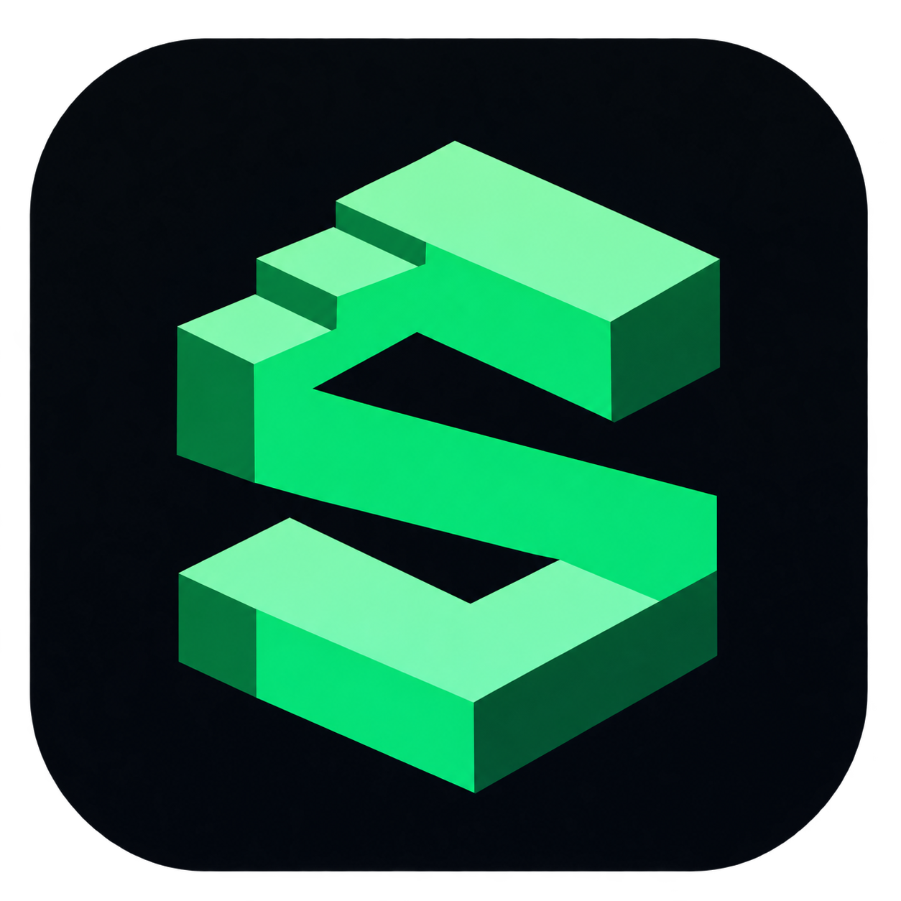
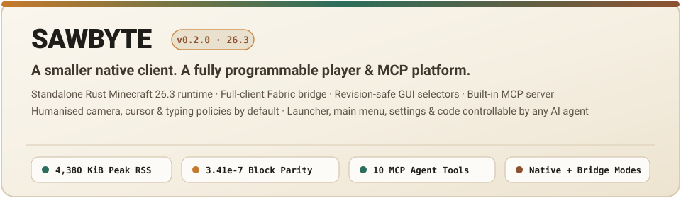

<p align="center">
  
</p>
<p align="center">
  
</p>
<p align="center">
  <a href="https://github.com/5ivesaw/Sawbyte/actions/workflows/ci.yml"></a>
  <a href="https://github.com/5ivesaw/Sawbyte/actions/workflows/player.yml"></a>
  
</p>
<p align="center">
  <a href="docs/VISION.md"><strong>Product vision</strong></a> ·
  <a href="docs/COVERAGE.md"><strong>Actual coverage</strong></a> ·
  <a href="PLAN.md"><strong>Plan</strong></a> ·
  <a href="docs/HANDOFF.md"><strong>Agent handoff</strong></a> ·
  <a href="docs/AUDIT-2026-11-03.md"><strong>Implementation audit</strong></a>
</p>

---

**Sawbyte aims to become a small, independent Rust Minecraft client with a fully programmable player.** Its native headless runtime is intended as the common foundation for automation, scripts, AI agents and neural-network experiments. A real launcher and optional normal-client integration are part of the goal.

**Current status: experimental prototype. The full product is unfinished.** General programmability means users can compose behaviours the authors never anticipated; it is not a catalogue of hardcoded workflows. See [the governing requirements](docs/VISION.md).

## What is Sawbyte? 
Normally, playing Minecraft requires launching the official graphical game—which consumes gigabytes of RAM, renders 3D graphics, and expects a human sitting at a keyboard and mouse. Existing bot libraries either spin up heavy headless Java instances or cut corners on client physics and network timing, causing servers to reject or flag them immediately.

**Sawbyte** is an independent, zero-graphics Minecraft Java client and universal automation engine written in Rust:

1. **Zero-Graphics, Tick-Accurate Rust Client**: It connects directly to Minecraft Java servers, tracks chunk/block/inventory/entity state in memory, and steps player movement at 20 Hz (`50 ms` ticks) without rendering a single pixel.
2. **Universal Building Blocks (Zero Hardcoding)**: Sawbyte is a foundational base engine—not built for any single server, minigame, or economy workflow. Instead of hardcoded scripts or fake simulated screens, it exposes composable primitives for movement, navigation, raycasting, block/entity interaction, and screen/container inspection based strictly on authoritative server state.
3. **Structured Code Observations for AI & Neural Networks**: Because there is no graphical window, Sawbyte exposes exact game observations directly as structured data—sub-voxel coordinates, velocity vectors, orientation, 3D local voxel patches, full item components/lore/damage, open container slots, and tracked entities—for Python/TypeScript scripts, MCP agents, and reinforcement-learning loops.

## Verified progress

- Foundation and native executable builds/tests pass on Linux x86-64, Windows x86-64 and macOS ARM64.
- The native 26.3 client connects to the controlled vanilla server, receives world data, and executes a real input recording.
- The Linux 160-tick walk/turn/jump/stop comparison matches the reference client with maximum position error of about 0.000000341 blocks and zero ground-state mismatches.
- A live command path can schedule movement. Persistent launcher metadata and actual child-process spawning exist.

Evidence: [foundation CI](https://github.com/5ivesaw/Sawbyte/actions/runs/41581827822), [player CI and downloadable evidence](https://github.com/5ivesaw/Sawbyte/actions/runs/41581827919), source commit d70a744. The latter recorded 5,080 KiB sampled native RSS for the replay and 5,112 KiB for the short interactive run. These are small Linux fixture measurements, not general resource budgets or competitor benchmarks.

## What still needs work

General interaction and screen automation, complete version-specific physics/state decoding, reliable task completion, standards-compatible MCP, training semantics, online account lifecycle, launcher UI/install/update/supervision, and broader version/platform gameplay validation remain unfinished.

The [audit](docs/AUDIT-2026-11-03.md) found production synthetic screen/result fallbacks, incomplete item decoding, input-rule bypasses, a navigation test that passes without arrival, and overstated completion claims. The documentation now records these as defects. Updating this README does not fix their implementation.

A 26.2 profile label exists in code; it is not a supported 26.2 client. The Fabric bridge is optional and secondary. A passing build is not certification of arbitrary-server operation or complete player equivalence.

## Experimental downloads

Open **Actions → Build and verify** or **Real player milestone → a successful run → Artifacts**. The two workflows package the CLI and native player separately. Archives include checksums and platform icons derived from the supplied PNG.

The current foundation artifacts are named by runner, such as `sawbyte-ubuntu-24.04-X64`, `sawbyte-windows-2022-X64` and `sawbyte-macos-14-ARM64`. Native artifacts use `sawbyte-play-linux-x64`, `sawbyte-play-windows-x64` and `sawbyte-play-macos-arm64`.

These are experimental command-line tools. There is no finished graphical launcher or supported general installation experience yet.

```text
sawbyte --help
sawbyte status 127.0.0.1:25565
sawbyte launcher list
sawbyte-play --help
```

Live experiments require matching block/protocol data, a controlled server and the limitations in [PLAYER.md](docs/PLAYER.md). MCP and SDK code exists, but broad external-client compatibility is not established.

## Architecture

```text
CLI / SDKs / AI adapters / optional UI
                  ↓
       observable actions and tasks
                  ↓
     shared validated input executor
                  ↓
  native Rust client → Minecraft server
                  ↑
   synchronized state, events and results

Launcher: instances, accounts, processes, installation and updates
Optional bridge: reference tests and normal graphical-client integration
```

This is the intended architecture. [COVERAGE.md](docs/COVERAGE.md) distinguishes implemented parts from missing connections and unverified behaviour.

| Component | Current purpose |
|---|---|
| `crates/sawbyte-core` | Typed scheduling, event/state models, early policies/tasks, launcher and control adapters |
| `crates/sawbyte-protocol` | Status/ping and bounded protocol primitives |
| `crates/sawbyte-cli` | Command-line diagnostics, launcher commands and control forwarding |
| `native/` | Independent experimental 26.3 client |
| `bridge/` | Optional Fabric reference replay/integration |
| `sdks/python`, `sdks/typescript` | Early controller bindings requiring further validation |

All compilation, tests, formatting and packaging run in GitHub Actions. Native gameplay has no Azalea or Java runtime dependency; the controlled lab runs an official Java server and reference client.

*Not an official Minecraft product. Not approved by or associated with Mojang or Microsoft.*
