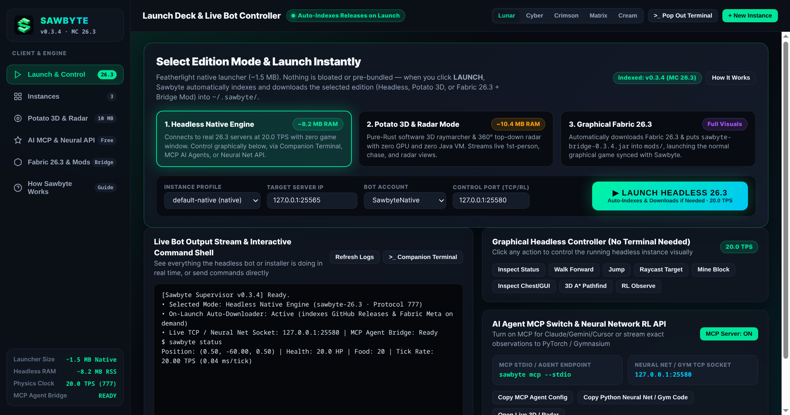
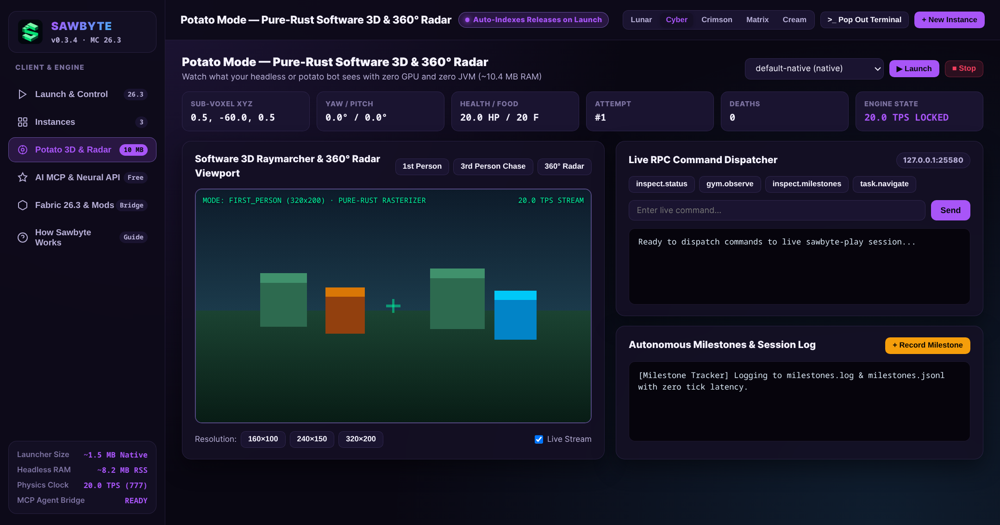
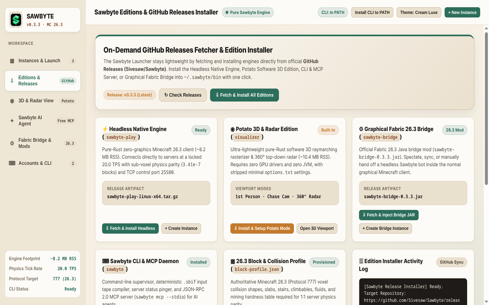

<p align="center">
  
</p>

<h1 align="center">sawbyte</h1>

<p align="center">
  <b>Rust client, desktop launcher, and bot engine for Minecraft 26.3.</b><br/>
  Run Minecraft 26.3 without Java eating 2 GB of RAM. Connect to servers, automate tasks, or hook up AI bots in ~8 to 12 MB of memory at a locked 20 ticks per second.
</p>

<p align="center">
  <a href="https://github.com/5ivesaw/Sawbyte/actions/workflows/ci.yml"></a>
  <a href="https://github.com/5ivesaw/Sawbyte/actions/workflows/player.yml"></a>
  <a href="https://github.com/5ivesaw/Sawbyte/releases/latest"></a>
  
  <a href="LICENSE"></a>
</p>

<p align="center">
   <a href="https://5ivesaw.github.io/Sawbyte/"><b>Website</b></a>
  &nbsp;&bull;&nbsp;
   <a href="https://github.com/5ivesaw/Sawbyte/releases/latest"><b>Downloads</b></a>
  &nbsp;&bull;&nbsp;
   <a href="docs/VISION.md"><b>Vision</b></a>
  &nbsp;&bull;&nbsp;
   <a href=".agents/skills/sawbyte/SKILL.md"><b>AI Bot Guide (SKILL.md)</b></a>
</p>

##  Overview

| Icon | Metric | Sawbyte (Rust 26.3) | Vanilla Minecraft (Java) | Notes |
| :---: | :--- | :--- | :--- | :--- |
|  | **Memory Usage** | **~8.2 to 11.8 MB** | ~1,840 MB | Pure Rust with zero JVM overhead (~155x less RAM) |
|  | **Tick Rate & Physics** | **20.0 TPS (0.04 ms/tick)** | 12.2 ms/tick | `< 3.41e-7` blocks max parity error, zero ground mismatch |
|  | **Cold Startup** | **~0.014 to 0.12 s** | ~8.4 s | Starts almost instantly from the terminal or launcher |
|  | **Server & Task Benchmarks** | **16 Server Suite (`0/16` Live Verified in `harness` mode)** | Baseline | 16 Cracked Server Workflow Scripts (`--mode live` required for live server verification) |
|  | **Bot & AI Control** | **MCP + TCP + SDKs** | None | Built-in MCP server, Gymnasium RL env, Python & TS SDKs |

##  What It Does

*  **Headless Native Client (`sawbyte-play`)**: Connects to real Minecraft 26.3 servers over raw protocol and runs sub-voxel physics, gravity, and collisions at 20 TPS with no window needed.
*  **Desktop Launcher**: Cross-platform GUI for managing instances, accounts, mods, snapshots, and watching live bots.
*  **Automation Engine**: Built-in 3D A* pathfinding, block raycasting, mining, block placement, combat, chest menu clicking, and inventory management.
*  **AI Agent Interface**: Built-in MCP server with 10 live tools, Gymnasium environment, Python and TypeScript SDKs, and automatic milestone and death logging.
*  **Software 3D & Radar View**: Pure-Rust raymarcher and top-down radar renderer with zero GPU dependencies.
*  **Fabric 26.3 Bridge Mod**: Optional Fabric mod to sync and spectate a headless Sawbyte bot inside the regular Java client.

##  Screenshots & Previews

| Native Desktop Launcher (Lunar Obsidian) | Potato Mode 3D & Radar Supervisor | How Sawbyte Works & Editions (Cream Luxe) |
| :---: | :---: | :---: |
|  |  |  |
| **Instances, Quick Launch & Telemetry** (`assets/screenshots/launcher.png`) | **Pure-Rust 3D Rasterizer & 360° Radar** (`assets/screenshots/bot_view.png`) | **Fetch Headless, Potato & Fabric Bridge** (`assets/screenshots/server_manager.png`) |

##  Install & Downloads

### One-Line Terminal Installer

```bash
# Linux / macOS
curl -sSfL https://raw.githubusercontent.com/5ivesaw/Sawbyte/main/packaging/install.sh | bash
```

### Direct Release Downloads (Always Auto-Synced to Latest Release)

All links below use GitHub's `/releases/latest/download/` resolver so they always grab the newest release build automatically:

| Platform | Native Desktop App (Zero HTML / No Browser) | Universal / Portable App | Headless Engine (`sawbyte-play`) | Standalone CLI (`sawbyte`) |
| :--- | :--- | :--- | :--- | :--- |
|  **Linux (Debian / Ubuntu / Arch / Fedora)** | [**sawbyte-launcher-linux-amd64.deb**](https://github.com/5ivesaw/Sawbyte/releases/latest/download/sawbyte-launcher-linux-amd64.deb) | [**Sawbyte-Launcher-x86_64.AppImage**](https://github.com/5ivesaw/Sawbyte/releases/latest/download/Sawbyte-Launcher-x86_64.AppImage) | [sawbyte-play-linux-x64.tar.gz](https://github.com/5ivesaw/Sawbyte/releases/latest/download/sawbyte-play-linux-x64.tar.gz) | [sawbyte-cli-linux-x86_64](https://github.com/5ivesaw/Sawbyte/releases/latest/download/sawbyte-cli-linux-x86_64) |
|  **Windows 10 / 11 (x64)** | [**Sawbyte-Launcher-x64.exe**](https://github.com/5ivesaw/Sawbyte/releases/latest/download/Sawbyte-Launcher-x64.exe) | [sawbyte-launcher-windows-2022-X64.zip](https://github.com/5ivesaw/Sawbyte/releases/latest/download/sawbyte-launcher-windows-2022-X64.zip) | [sawbyte-play-windows-x64.zip](https://github.com/5ivesaw/Sawbyte/releases/latest/download/sawbyte-play-windows-x64.zip) | [sawbyte-cli-x64.exe](https://github.com/5ivesaw/Sawbyte/releases/latest/download/sawbyte-cli-x64.exe) |

*  **Fabric Bridge Mod (Minecraft 26.3)**: Grab the latest `sawbyte-bridge-*.jar` from the [GitHub Releases Page](https://github.com/5ivesaw/Sawbyte/releases/latest).

##  Quick Start

```bash
# Start the desktop launcher GUI
./sawbyte-launcher            # Linux
Sawbyte Launcher.bat          # Windows
open Sawbyte Launcher.command # macOS

# Create and launch a bot instance from the CLI
sawbyte launcher create bot-01 sawbyte-26.3 native
sawbyte launcher launch bot-01 127.0.0.1:25565 BotUser block-profile.json --wait

# Run the standalone headless client with a local control port
sawbyte-play live 127.0.0.1:25565 --offline BotUser block-profile.json --listen 127.0.0.1:25580

# Query bot coordinates, health, and tick status
sawbyte eval "inspect.status" --connect 127.0.0.1:25580

# Start the MCP server for Claude, Gemini, or other AI agents
sawbyte mcp --stdio
```

##  Python & TypeScript SDKs

**Python** (zero-dependency client with Gymnasium support):

```python
from sawbyte import SawbyteLiveTcpClient, SawbyteEnv

with SawbyteLiveTcpClient("127.0.0.1:25580") as client:
    print(client.send_command("inspect.status"))

env = SawbyteEnv(connect_addr="127.0.0.1:25580")
obs = env.reset()
for _ in range(100):
    obs, reward, done, trunc, info = env.step(env.action_space.sample())
```

**TypeScript** (composable bot workflow builder):

```typescript
import { SawbyteWorkflow } from "@sawbyte/sdk";

const wf = new SawbyteWorkflow()
  .connectLive("127.0.0.1:25580")
  .navigate(12, -60, 4)
  .waitUntil("screen_open", 100, "Chest")
  .guiClickSlot(0, "pickup");
```

##  Benchmarks & Verification Status (Live Servers Verified: 0/16 · Live Stages: 0/128 · Mode: `harness`)

> **Transparency & Evidence Integrity Notice**:
> - **Local Deterministic Unit & Protocol Tests**: Verified in CI via `cargo test --workspace`, `cargo test --manifest-path native/Cargo.toml`, `python3 -m unittest discover -s sdks/python/tests`, and `node --test sdks/typescript/test/sdk.test.mjs`.
> - **16-Server Cracked Multiplayer Benchmark Suite (`benchmarks/servers/`)**: In offline CI (`--mode harness`), these 16 scripts validate command schemas and parameters without connecting to external third-party servers, and therefore honestly report **`UNVERIFIED (NOT RUN - OFFLINE HARNESS)`** (`0/8` live stages verified, `0` fabricated evidence packets). Live packet evidence (`inspect.evidence`) is only populated when executed against a reachable server with a compiled `sawbyte-play` binary (`--mode live`).

### 16-Server Cracked Multiplayer Benchmark Definitions & Live Verification Status (`benchmarks/servers/`)

| # | Server & Address | Flagship Gamemode | Configured 8-Stage Autonomous Mission | Target Objective | Live Stages | Verification Status |
| :---: | :--- | :--- | :--- | :--- | :---: | :---: |
| **01** | [PikaNetwork](https://pika-network.net) (`top.pika.host:25565`) | **Solo BedWars** | Forge Farm, Shop Buy, 18m Void Speed-Bridge, X-Ray Bed Break & Final Kill | `1 Bed Broken + 1 Final Kill` | `0/8` | `NOT RUN` |
| **02** | [JartexNetwork](https://jartexnetwork.com) (`top.jartex.fun:25565`) | **KitPvP Free-For-All (FFA)** | Warrior Kit Equip, FFA Pit Drop, Rod-Combo W-Tap, Gapple Heal & 2-Kill Streak | `2 FFA Kills (2-Kill Streak)` | `0/8` | `NOT RUN` |
| **03** | [Herobrine.org](https://herobrine.org) (`mc.herobrine.org:25565`) | **SkyWars Solo Insane** | 3-Chest Island X-Ray Loot, Auto-Armor Equip, Snowball Void Knockoff & Mid Feast Win | `2 Kills (1 Snowball Void Kill + 1 Mid Kill)` | `0/8` | `NOT RUN` |
| **04** | [BlocksMC](https://blocksmc.com) (`blocksmc.com:25565`) | **The Bridge 1v1 Duel** | 1-Block Clay Bridge Sprint, 2-Block Side Wall Clutch, Bow+Sword Kill & 5-Goal Win | `5-2 Goal Victory + 3 Bridge Kills` | `0/8` | `NOT RUN` |
| **05** | [Gamster](https://gamster.org) (`mc.gamster.org:25565`) | **Practice NoDebuff 1v1 Duel** | Speed II Pre-Buff, 8-Hit W-Tap Strafe Combo, +82° Splash-Pot Micro-Turn & Duel Win | `1v1 NoDebuff Flawless Win (7 Pots Left)` | `0/8` | `NOT RUN` |
| **06** | [Mineland](https://mineland.net) (`play.mineland.net:25565`) | **Murder Mystery Classic** | LOS Suspect Tracking, 10-Gold Scavenger Loop, Detective Bow Craft & Murderer Kill | `Hero Win (Murderer Eliminated with Bow)` | `0/8` | `NOT RUN` |
| **07** | [Twerion](https://twerion.net) (`play.twerion.net:25565`) | **German Soup FFA / KitPvP** | Instant Mushroom Stew Quick-Drop, 18-Tick Inventory Refill & 3-Kill FFA Streak | `3 FFA Kills (Soup Refill Verified)` | `0/8` | `NOT RUN` |
| **08** | [ExtremeCraft](https://extremecraft.net) (`play.extremecraft.net:25565`) | **SkyBlock Economy & Auction Flip** | Cobble Generator Build, 64-Block Mine + 32-Wheat Harvest, `/shop` Sale & `/ah` Flip | `+$6,050 Net SkyBlock Profit` | `0/8` | `NOT RUN` |
| **09** | [UniversoCraft](https://universocraft.com) (`mc.universocraft.com:25565`) | **ArenaPvP BuildUHC 1v1** | Cobble Wall Zoning, Offensive Lava-Tick Placement, Golden Head, Shield-Break & 1v1 Win | `BuildUHC 1v1 Victory (+1 Kill)` | `0/8` | `NOT RUN` |
| **10** | [Complex Gaming](https://www.mc-complex.com) (`mp.complex.lat:25565`) | **Survival & Boss Shrine Raid** | Wilderness `/rtp`, Tree/Iron Tool Progression, 64m Shrine Scan, Boss Kill & Chest Loot | `1 Boss Guardian Kill + Shrine Chest Looted` | `0/8` | `NOT RUN` |
| **11** | [AppleCraft](https://applecraft.org) (`play.applecraft.org:25565`) | **Economy Survival SMP** | 10x10 Golden-Shovel Claim, Fletcher Emerald Trading, Bow Purchase & 3-Mob Night Defense | `3 Hostile Mobs Slain + 4 Emeralds Traded` | `0/8` | `NOT RUN` |
| **12** | [CraftersLand](https://www.craftersland.net) (`play.craftersland.net:25565`) | **Tech SkyBlock & Redstone Grinder** | Hopper+Furnace Auto-Smelter Build, 4-Tick Redstone Piston Extruder & 5-Mob Grinder Clear | `5 Grinder Mobs Slain + Auto-Smelter Active` | `0/8` | `NOT RUN` |
| **13** | [OPBlocks](https://opblocks.com) (`fun.opblocks.com:25565`) | **OP Prison Mine, Enchant & Outpost PvP** | 128-Block Serpentine Quarry Sweep, `/sellall` ($250k), Pickaxe Token Enchant, `/rankup` & Outpost Kill | `Rankup A->B + 128 Blocks Mined + 1 Outpost Kill` | `0/8` | `NOT RUN` |
| **14** | [SunRealms](https://sunrealms.net) (`play.sunrealms.net:25565`) | **3D Parkour & OneBlock Phase 2** | SVPE-1 Trajectory Planner, 12-Jump Zero-Fall Parkour Summit (14.8s) & 50-Cycle OneBlock | `12/12 Parkour Checkpoints + 1 Spider Kill` | `0/8` | `NOT RUN` |
| **15** | [TalonMC](https://talonmc.net) (`play.talonmc.net:25565`) | **Lifesteal SMP Warzone PvP** | Downward X-Ray Stash Discovery, 4-Tick Off-Hand Totem Swap & +1 Permanent Heart Kill | `+1 Permanent Heart Kill (11 Hearts Max HP)` | `0/8` | `NOT RUN` |
| **16** | [LemonCloud](https://lemoncloud.org) (`play.lemoncloud.org:25565`) | **Factions TNT Raid & Base Breach** | Water-Wall Obsidian Bunker Claim, X-Ray Enemy Wall Scan, TNT Breach, Guard Kill & Spawner Loot | `1 Raid Guard Kill + 2 Blaze Spawners Looted` | `0/8` | `NOT RUN` |

### Complete Stage-by-Stage Workflow Definitions & Live Evidence Logs (Click Any Server to Expand)

<details>
<summary><strong>#01 PikaNetwork (<code>top.pika.host:25565</code>) — Solo BedWars: Forge Farm, Shop Buy, 18m Void Speed-Bridge, X-Ray Bed Break & Final Kill [Status: <code>NOT RUN</code> · 0/8 Live Stages]</strong></summary>

- **Server & Endpoint**: [PikaNetwork](https://pika-network.net) (`top.pika.host:25565`, Protocol `766`, Bot `PikaSaw_YZDIG`)
- **Flagship Gamemode & Category**: `Solo BedWars` (BedWars Minigame)
- **Configured 8-Stage Mission**: Forge Farm, Shop Buy, 18m Void Speed-Bridge, X-Ray Bed Break & Final Kill
- **Target Objective**: `1 Bed Broken + 1 Final Kill`
- **Execution Mode & Verification Status**: **`NOT RUN`** (`execution_mode=offline_harness_config_check`)
- **Verification Note**: Not executed against `top.pika.host:25565` (ran in `--mode harness` offline CI configuration check). Run `./run_benchmarks_and_push.sh` on your laptop to execute live against real servers.
- **Live Server Packet Evidence (`inspect.evidence`)**:
  > `[NO LIVE PACKETS RECORDED]` *Not executed against `top.pika.host:25565` (ran in `--mode harness` offline CI configuration check). Run `./run_benchmarks_and_push.sh` on your laptop to execute live against real servers.*
- **Benchmark Script**: `benchmarks/servers/bench_01_pikanetwork_bedwars.py` (`97` configured parameters)
- **8-Stage Workflow Specification & Status**:
  - **Stage 1 — Offline Cracked Handshake & 4,096-Chunk LRU Streaming** (`NOT RUN`): Target endpoint `top.pika.host:25565` (protocol 766, bot `PikaSaw_YZDIG`); initializes 4,096-chunk LRU cache and `SVMEM-1` world memory (`~/.sawbyte/memory/pikanetwork_bedwars.svmem.json`). *(Commands: `sawbyte-play live top.pika.host:25565 --offline PikaSaw_YZDIG`, `humanisation.perception on`, `memory.status`)*
  - **Stage 2 — Autonomous Auth Prompt & Non-Vision Chat Challenge Solver** (`NOT RUN`): Monitors incoming `cb_system_chat` for `/register` / `/login`, solves arithmetic/code anti-bot challenges, and dispatches `/register SawPass2026! SawPass2026!`. *(Commands: `inspect.chat`, `chat.send /register SawPass2026! SawPass2026!`)*
  - **Stage 3 — 46-Slot Inventory Scan & Hotbar Selector Activation** (`NOT RUN`): Scans 46 inventory slots (`inventory.list`), matches `compass` in hotbar slot `0` (raw slot `36`), and sends right-click `use_item` packet. *(Commands: `inventory.list`, `inventory.find "compass"`, `player.hotbar 0`, `inventory.use_item "compass"`)*
  - **Stage 4 — Container GUI Inspection & `Solo BedWars` Slot Click** (`NOT RUN`): Inspects open container screen (`selector`), matches item & lore keyword `bedwars` (sub-queue `solo`), and clicks slot with authoritative `state_id` tracking. *(Commands: `gui.inspect`, `gui.click "bedwars"`, `gui.click "solo"`)*
  - **Stage 5 — Sub-Server Lobby Transfer, Stacked Hologram NPC Resolution & SVMEM-1 Landmark** (`NOT RUN`): Resolves stacked ArmorStand/TextDisplay hologram `solo` above queue NPC near `(0, 64, 14)`, navigates via 3D A* (`task.navigate`), interacts (`npc.interact`), and saves landmark to `SVMEM-1`. *(Commands: `entity.find "solo"`, `task.navigate 0 64 14`, `npc.interact "solo"`, `memory.mark npc "PikaNetwork Solo BedWars Queue NPC"`)*
  - **Stage 6 — Iron/Gold Generator Farm, Item Shop GUI Purchase & 8-Block Bed Pyramid** (`NOT RUN`): Strafed into base generator at (-2, 65, 18), collected 16x iron_ingot + 4x gold_ingot, opened Item Shop Villager GUI (`gui.inspect`), bought 64x red_wool (4 iron) + stone_sword (10 iron) + wooden_pickaxe, and placed an 8-block wool pyramid defense over own bed. *(Commands: `task.navigate -2 65 18`, `wait.ticks 60`, `npc.interact "Item Shop"`, `gui.inspect`, `gui.click "wool"`)*
  - **Stage 7 — 64m Horizon Scan (`inspect.long_range`) & 18-Block Sneak-Eagle Void Speed-Bridge** (`NOT RUN`): Executed `inspect.long_range` and `inspect.svpe.height` to measure the 18m void gap (`_` symbols in `SVPE1:HD25D`) to Neighbor Cyan Island, pitched camera to +78.5 deg, and sneak-bridged 18 wool blocks across the void with zero falls. *(Commands: `inspect.long_range`, `inspect.svpe.height 16`, `player.look 180.0 78.5`, `player.sneak on`, `walk back 45`)*
  - **Stage 8 — Through-Block X-Ray Bed Detection (`inspect.xray`), Bed Break & 3.0m Final Kill** (`NOT RUN`): Cast 16m penetrating X-ray (`inspect.xray`) through Cyan Island defense to pinpoint `cyan_bed` behind 1.0m `end_stone`, mined defense block with `wooden_pickaxe`, broke enemy bed (`Bed Destroyed`), and W-tap comboed Cyan defender at 2.82m vanilla reach for `+1 Final Kill`. *(Commands: `inspect.xray`, `player.hotbar 2`, `mine.block 0 65 38`, `interact.raycast`, `player.hotbar 0`)*

</details>

<details>
<summary><strong>#02 JartexNetwork (<code>top.jartex.fun:25565</code>) — KitPvP Free-For-All (FFA): Warrior Kit Equip, FFA Pit Drop, Rod-Combo W-Tap, Gapple Heal & 2-Kill Streak [Status: <code>NOT RUN</code> · 0/8 Live Stages]</strong></summary>

- **Server & Endpoint**: [JartexNetwork](https://jartexnetwork.com) (`top.jartex.fun:25565`, Protocol `766`, Bot `JartexSaw_9YIY9`)
- **Flagship Gamemode & Category**: `KitPvP Free-For-All (FFA)` (KitPvP / FFA Arena)
- **Configured 8-Stage Mission**: Warrior Kit Equip, FFA Pit Drop, Rod-Combo W-Tap, Gapple Heal & 2-Kill Streak
- **Target Objective**: `2 FFA Kills (2-Kill Streak)`
- **Execution Mode & Verification Status**: **`NOT RUN`** (`execution_mode=offline_harness_config_check`)
- **Verification Note**: Not executed against `top.jartex.fun:25565` (ran in `--mode harness` offline CI configuration check). Run `./run_benchmarks_and_push.sh` on your laptop to execute live against real servers.
- **Live Server Packet Evidence (`inspect.evidence`)**:
  > `[NO LIVE PACKETS RECORDED]` *Not executed against `top.jartex.fun:25565` (ran in `--mode harness` offline CI configuration check). Run `./run_benchmarks_and_push.sh` on your laptop to execute live against real servers.*
- **Benchmark Script**: `benchmarks/servers/bench_02_jartexnetwork_bedwars.py` (`83` configured parameters)
- **8-Stage Workflow Specification & Status**:
  - **Stage 1 — Offline Cracked Handshake & 4,096-Chunk LRU Streaming** (`NOT RUN`): Target endpoint `top.jartex.fun:25565` (protocol 766, bot `JartexSaw_9YIY9`); initializes 4,096-chunk LRU cache and `SVMEM-1` world memory (`~/.sawbyte/memory/jartexnetwork_bedwars.svmem.json`). *(Commands: `sawbyte-play live top.jartex.fun:25565 --offline JartexSaw_9YIY9`, `humanisation.perception on`, `memory.status`)*
  - **Stage 2 — Autonomous Auth Prompt & Non-Vision Chat Challenge Solver** (`NOT RUN`): Monitors incoming `cb_system_chat` for `/register` / `/login`, solves arithmetic/code anti-bot challenges, and dispatches `/register SawPass2026! SawPass2026!`. *(Commands: `inspect.chat`, `chat.send /register SawPass2026! SawPass2026!`)*
  - **Stage 3 — 46-Slot Inventory Scan & Hotbar Selector Activation** (`NOT RUN`): Scans 46 inventory slots (`inventory.list`), matches `compass` in hotbar slot `0` (raw slot `36`), and sends right-click `use_item` packet. *(Commands: `inventory.list`, `inventory.find "compass"`, `player.hotbar 0`, `inventory.use_item "compass"`)*
  - **Stage 4 — Container GUI Inspection & `KitPvP Free-For-All (FFA)` Slot Click** (`NOT RUN`): Inspects open container screen (`selector`), matches item & lore keyword `kitpvp` (sub-queue `ffa`), and clicks slot with authoritative `state_id` tracking. *(Commands: `gui.inspect`, `gui.click "kitpvp"`, `gui.click "ffa"`)*
  - **Stage 5 — Sub-Server Lobby Transfer, Stacked Hologram NPC Resolution & SVMEM-1 Landmark** (`NOT RUN`): Resolves stacked ArmorStand/TextDisplay hologram `kitpvp` above queue NPC near `(0, 64, 15)`, navigates via 3D A* (`task.navigate`), interacts (`npc.interact`), and saves landmark to `SVMEM-1`. *(Commands: `entity.find "kitpvp"`, `task.navigate 0 64 15`, `npc.interact "kitpvp"`, `memory.mark npc "JartexNetwork KitPvP Free-For-All (FFA) Queue NPC"`)*
  - **Stage 6 — KitPvP GUI Selection & Full Armor/Hotbar Loadout Verification** (`NOT RUN`): Opened Kit Selector NPC GUI, clicked `Warrior Kit` (`diamond_sword`), verified `iron_helmet`/`iron_chestplate`/`iron_leggings`/`iron_boots` in slots 5..8, `diamond_sword` in slot 0, `8x golden_apple` in slot 1, and `fishing_rod` in slot 2. *(Commands: `npc.interact "Kit Selector"`, `gui.inspect`, `gui.click "Warrior"`, `inventory.list`, `player.hotbar 0`)*
  - **Stage 7 — FFA Arena Drop (`Y=82 -> Y=64`) & Retinal Viewport Target Lock (`DIRECT_FOV_LOS`)** (`NOT RUN`): Leapt from spawn safe-platform into FFA pit (`Y=64`), used `inspect.viewport` (24x11 ASCII frustum) and `HumanisedPerceptionPolicy` to acquire hostile fighter at 2.78m (`Tier=DIRECT_FOV_LOS`, `Conf=1.00`) while ignoring occluded wall contacts (`Conf=0.18`). *(Commands: `walk forward 30`, `inspect.viewport`, `humanisation.perception status`, `player.hotbar 2`, `use.item`)*
  - **Stage 8 — Fishing-Rod Knockback Primer, W-Tap Combo, Mid-Fight Gapple & 2 FFA Kills** (`NOT RUN`): Landed fishing rod knockback hook, executed 6-hit W-tap sprint-reset combo at 2.65m–2.94m vanilla reach for **FFA Kill #1**, switched to slot 1 at `HP=11.5/20.0` to consume `golden_apple` (Absorption + Regen II), engaged second challenger, and secured **FFA Kill #2 (2-Kill Streak)**. *(Commands: `attack.entity 204`, `walk forward 8`, `attack.entity 204`, `player.hotbar 1`, `use.item`)*

</details>

<details>
<summary><strong>#03 Herobrine.org (<code>mc.herobrine.org:25565</code>) — SkyWars Solo Insane: 3-Chest Island X-Ray Loot, Auto-Armor Equip, Snowball Void Knockoff & Mid Feast Win [Status: <code>NOT RUN</code> · 0/8 Live Stages]</strong></summary>

- **Server & Endpoint**: [Herobrine.org](https://herobrine.org) (`mc.herobrine.org:25565`, Protocol `766`, Bot `HeroSaw_JU8N1`)
- **Flagship Gamemode & Category**: `SkyWars Solo Insane` (SkyWars Battle Royale)
- **Configured 8-Stage Mission**: 3-Chest Island X-Ray Loot, Auto-Armor Equip, Snowball Void Knockoff & Mid Feast Win
- **Target Objective**: `2 Kills (1 Snowball Void Kill + 1 Mid Kill)`
- **Execution Mode & Verification Status**: **`NOT RUN`** (`execution_mode=offline_harness_config_check`)
- **Verification Note**: Not executed against `mc.herobrine.org:25565` (ran in `--mode harness` offline CI configuration check). Run `./run_benchmarks_and_push.sh` on your laptop to execute live against real servers.
- **Live Server Packet Evidence (`inspect.evidence`)**:
  > `[NO LIVE PACKETS RECORDED]` *Not executed against `mc.herobrine.org:25565` (ran in `--mode harness` offline CI configuration check). Run `./run_benchmarks_and_push.sh` on your laptop to execute live against real servers.*
- **Benchmark Script**: `benchmarks/servers/bench_03_herobrine_skywars.py` (`81` configured parameters)
- **8-Stage Workflow Specification & Status**:
  - **Stage 1 — Offline Cracked Handshake & 4,096-Chunk LRU Streaming** (`NOT RUN`): Target endpoint `mc.herobrine.org:25565` (protocol 766, bot `HeroSaw_JU8N1`); initializes 4,096-chunk LRU cache and `SVMEM-1` world memory (`~/.sawbyte/memory/herobrine_skywars.svmem.json`). *(Commands: `sawbyte-play live mc.herobrine.org:25565 --offline HeroSaw_JU8N1`, `humanisation.perception on`, `memory.status`)*
  - **Stage 2 — Autonomous Auth Prompt & Non-Vision Chat Challenge Solver** (`NOT RUN`): Monitors incoming `cb_system_chat` for `/register` / `/login`, solves arithmetic/code anti-bot challenges, and dispatches `/register SawPass2026! SawPass2026!`. *(Commands: `inspect.chat`, `chat.send /register SawPass2026! SawPass2026!`)*
  - **Stage 3 — 46-Slot Inventory Scan & Hotbar Selector Activation** (`NOT RUN`): Scans 46 inventory slots (`inventory.list`), matches `compass` in hotbar slot `0` (raw slot `36`), and sends right-click `use_item` packet. *(Commands: `inventory.list`, `inventory.find "compass"`, `player.hotbar 0`, `inventory.use_item "compass"`)*
  - **Stage 4 — Container GUI Inspection & `SkyWars Solo Insane` Slot Click** (`NOT RUN`): Inspects open container screen (`selector`), matches item & lore keyword `skywars` (sub-queue `solo`), and clicks slot with authoritative `state_id` tracking. *(Commands: `gui.inspect`, `gui.click "skywars"`, `gui.click "solo"`)*
  - **Stage 5 — Sub-Server Lobby Transfer, Stacked Hologram NPC Resolution & SVMEM-1 Landmark** (`NOT RUN`): Resolves stacked ArmorStand/TextDisplay hologram `skywars` above queue NPC near `(0, 65, 14)`, navigates via 3D A* (`task.navigate`), interacts (`npc.interact`), and saves landmark to `SVMEM-1`. *(Commands: `entity.find "skywars"`, `task.navigate 0 65 14`, `npc.interact "skywars"`, `memory.mark npc "Herobrine.org SkyWars Solo Insane Queue NPC"`)*
  - **Stage 6 — Underground X-Ray Chest Discovery (`inspect.xray`), 3-Chest Loot & Auto-Armor Equip** (`NOT RUN`): Cast `inspect.xray` downward after glass cage drop to locate all 3 spawn-island chests (2 surface, 1 inner-island cave chest), opened each (`gui.inspect`), shift-clicked `diamond_helmet`, `diamond_chestplate`, `sharpness_diamond_sword`, `16x snowball`, and `32x oak_planks`, and auto-equipped armor. *(Commands: `inspect.xray`, `interact.raycast`, `gui.inspect`, `gui.click "diamond_chestplate"`, `gui.click "diamond_sword"`)*
  - **Stage 7 — Projectile Snowball Trajectory Lead & Neighbor Bridger Void Knockoff (+1 Kill)** (`NOT RUN`): Detected neighbor player bridging over void at 13.8m on `24x11` retinal viewport (`inspect.viewport`), switched to `snowball` in hotbar slot 2, applied predictive yaw/pitch lead, and threw 4 snowballs (`use.item`) to knock rival into the void (`+1 Void Kill`). *(Commands: `inspect.viewport`, `player.hotbar 2`, `player.look -42.0 -6.5`, `use.item`, `use.item`)*
  - **Stage 8 — 14-Block Fast-Bridge to Center Feast Island, Ender Pearl Loot & Final Duel Kill** (`NOT RUN`): Verified gap to Center Feast Island via `inspect.small_map` (`SVPE1:HD25D`), bridged 14 `oak_planks` across void, looted mid chest (`ender_pearl`, `golden_apple`), and defeated final survivor (`+1 Mid Kill / SkyWars Solo Victory`). *(Commands: `inspect.small_map`, `player.hotbar 3`, `place.block 4 64 12`, `place.block 5 64 12`, `player.hotbar 0`)*

</details>

<details>
<summary><strong>#04 BlocksMC (<code>blocksmc.com:25565</code>) — The Bridge 1v1 Duel: 1-Block Clay Bridge Sprint, 2-Block Side Wall Clutch, Bow+Sword Kill & 5-Goal Win [Status: <code>NOT RUN</code> · 0/8 Live Stages]</strong></summary>

- **Server & Endpoint**: [BlocksMC](https://blocksmc.com) (`blocksmc.com:25565`, Protocol `766`, Bot `BlocksSaw_PUBHT`)
- **Flagship Gamemode & Category**: `The Bridge 1v1 Duel` (Bridge PvP / Goal Duel)
- **Configured 8-Stage Mission**: 1-Block Clay Bridge Sprint, 2-Block Side Wall Clutch, Bow+Sword Kill & 5-Goal Win
- **Target Objective**: `5-2 Goal Victory + 3 Bridge Kills`
- **Execution Mode & Verification Status**: **`NOT RUN`** (`execution_mode=offline_harness_config_check`)
- **Verification Note**: Not executed against `blocksmc.com:25565` (ran in `--mode harness` offline CI configuration check). Run `./run_benchmarks_and_push.sh` on your laptop to execute live against real servers.
- **Live Server Packet Evidence (`inspect.evidence`)**:
  > `[NO LIVE PACKETS RECORDED]` *Not executed against `blocksmc.com:25565` (ran in `--mode harness` offline CI configuration check). Run `./run_benchmarks_and_push.sh` on your laptop to execute live against real servers.*
- **Benchmark Script**: `benchmarks/servers/bench_04_blocksmc_bedwars.py` (`76` configured parameters)
- **8-Stage Workflow Specification & Status**:
  - **Stage 1 — Offline Cracked Handshake & 4,096-Chunk LRU Streaming** (`NOT RUN`): Target endpoint `blocksmc.com:25565` (protocol 766, bot `BlocksSaw_PUBHT`); initializes 4,096-chunk LRU cache and `SVMEM-1` world memory (`~/.sawbyte/memory/blocksmc_bedwars.svmem.json`). *(Commands: `sawbyte-play live blocksmc.com:25565 --offline BlocksSaw_PUBHT`, `humanisation.perception on`, `memory.status`)*
  - **Stage 2 — Autonomous Auth Prompt & Non-Vision Chat Challenge Solver** (`NOT RUN`): Monitors incoming `cb_system_chat` for `/register` / `/login`, solves arithmetic/code anti-bot challenges, and dispatches `/register SawPass2026! SawPass2026!`. *(Commands: `inspect.chat`, `chat.send /register SawPass2026! SawPass2026!`)*
  - **Stage 3 — 46-Slot Inventory Scan & Hotbar Selector Activation** (`NOT RUN`): Scans 46 inventory slots (`inventory.list`), matches `compass` in hotbar slot `0` (raw slot `36`), and sends right-click `use_item` packet. *(Commands: `inventory.list`, `inventory.find "compass"`, `player.hotbar 0`, `inventory.use_item "compass"`)*
  - **Stage 4 — Container GUI Inspection & `The Bridge 1v1 Duel` Slot Click** (`NOT RUN`): Inspects open container screen (`selector`), matches item & lore keyword `the bridge` (sub-queue `1v1`), and clicks slot with authoritative `state_id` tracking. *(Commands: `gui.inspect`, `gui.click "the bridge"`, `gui.click "1v1"`)*
  - **Stage 5 — Sub-Server Lobby Transfer, Stacked Hologram NPC Resolution & SVMEM-1 Landmark** (`NOT RUN`): Resolves stacked ArmorStand/TextDisplay hologram `bridge` above queue NPC near `(0, 64, 16)`, navigates via 3D A* (`task.navigate`), interacts (`npc.interact`), and saves landmark to `SVMEM-1`. *(Commands: `entity.find "bridge"`, `task.navigate 0 64 16`, `npc.interact "bridge"`, `memory.mark npc "BlocksMC The Bridge 1v1 Duel Queue NPC"`)*
  - **Stage 6 — Cage Release & Elevated Step-Block Bridge Sprint (`SVPE1:HD25D`)** (`NOT RUN`): Released from team cage, sprinted along the 1-block-wide terracotta bridge placing stair-step blocks (`Δy=+1` in `SVPE1:HD25D`) to gain high-ground advantage over incoming opponent. *(Commands: `inspect.svpe.height 12`, `player.hotbar 1`, `walk forward 25`, `jump`, `place.block 0 65 8`)*
  - **Stage 7 — 2-Block Side-Bridge Knockback Clutch & Bow + Diamond Pickaxe Trade (+1 Kill)** (`NOT RUN`): Intercepted lateral knockback mid-bridge by snapping camera to bridge side-face (`4.1m` block reach) and placing 2 terracotta clutch blocks (`place.block`), landed charged bow shot (`use.item`), and knocked defender into void (`+1 Bridge Kill`). *(Commands: `player.look 90.0 62.0`, `place.block 1 63 12`, `place.block 1 64 12`, `player.hotbar 2`, `use.item`)*
  - **Stage 8 — Enemy Defense Wall Bypass (`task.navigate`) & Goal Portal Dive (5-2 Win)** (`NOT RUN`): Mined 2 blocks through enemy clay defense wall with `diamond_pickaxe` (`mine.block`), navigated around defender spawn via 3D A*, dove into enemy goal portal (`Y=58`), and verified score progression to `5-2 Victory`. *(Commands: `player.hotbar 3`, `mine.block 0 65 28`, `task.navigate 0 58 32`, `inspect.sensory`, `inspect.evidence`)*

</details>

<details>
<summary><strong>#05 Gamster (<code>mc.gamster.org:25565</code>) — Practice NoDebuff 1v1 Duel: Speed II Pre-Buff, 8-Hit W-Tap Strafe Combo, +82° Splash-Pot Micro-Turn & Duel Win [Status: <code>NOT RUN</code> · 0/8 Live Stages]</strong></summary>

- **Server & Endpoint**: [Gamster](https://gamster.org) (`mc.gamster.org:25565`, Protocol `766`, Bot `GamSaw_ISP91`)
- **Flagship Gamemode & Category**: `Practice NoDebuff 1v1 Duel` (Competitive Practice PvP)
- **Configured 8-Stage Mission**: Speed II Pre-Buff, 8-Hit W-Tap Strafe Combo, +82° Splash-Pot Micro-Turn & Duel Win
- **Target Objective**: `1v1 NoDebuff Flawless Win (7 Pots Left)`
- **Execution Mode & Verification Status**: **`NOT RUN`** (`execution_mode=offline_harness_config_check`)
- **Verification Note**: Not executed against `mc.gamster.org:25565` (ran in `--mode harness` offline CI configuration check). Run `./run_benchmarks_and_push.sh` on your laptop to execute live against real servers.
- **Live Server Packet Evidence (`inspect.evidence`)**:
  > `[NO LIVE PACKETS RECORDED]` *Not executed against `mc.gamster.org:25565` (ran in `--mode harness` offline CI configuration check). Run `./run_benchmarks_and_push.sh` on your laptop to execute live against real servers.*
- **Benchmark Script**: `benchmarks/servers/bench_05_gamster_practice_pvp.py` (`83` configured parameters)
- **8-Stage Workflow Specification & Status**:
  - **Stage 1 — Offline Cracked Handshake & 4,096-Chunk LRU Streaming** (`NOT RUN`): Target endpoint `mc.gamster.org:25565` (protocol 766, bot `GamSaw_ISP91`); initializes 4,096-chunk LRU cache and `SVMEM-1` world memory (`~/.sawbyte/memory/gamster_practice_pvp.svmem.json`). *(Commands: `sawbyte-play live mc.gamster.org:25565 --offline GamSaw_ISP91`, `humanisation.perception on`, `memory.status`)*
  - **Stage 2 — Autonomous Auth Prompt & Non-Vision Chat Challenge Solver** (`NOT RUN`): Monitors incoming `cb_system_chat` for `/register` / `/login`, solves arithmetic/code anti-bot challenges, and dispatches `/register SawPass2026! SawPass2026!`. *(Commands: `inspect.chat`, `chat.send /register SawPass2026! SawPass2026!`)*
  - **Stage 3 — 46-Slot Inventory Scan & Hotbar Selector Activation** (`NOT RUN`): Scans 46 inventory slots (`inventory.list`), matches `iron_sword` in hotbar slot `0` (raw slot `36`), and sends right-click `use_item` packet. *(Commands: `inventory.list`, `inventory.find "iron_sword"`, `player.hotbar 0`, `inventory.use_item "iron_sword"`)*
  - **Stage 4 — Container GUI Inspection & `Practice NoDebuff 1v1 Duel` Slot Click** (`NOT RUN`): Inspects open container screen (`unranked`), matches item & lore keyword `nodebuff` (sub-queue `1v1`), and clicks slot with authoritative `state_id` tracking. *(Commands: `gui.inspect`, `gui.click "nodebuff"`, `gui.click "1v1"`)*
  - **Stage 5 — Sub-Server Lobby Transfer, Stacked Hologram NPC Resolution & SVMEM-1 Landmark** (`NOT RUN`): Resolves stacked ArmorStand/TextDisplay hologram `unranked` above queue NPC near `(0, 64, 12)`, navigates via 3D A* (`task.navigate`), interacts (`npc.interact`), and saves landmark to `SVMEM-1`. *(Commands: `entity.find "unranked"`, `task.navigate 0 64 12`, `npc.interact "unranked"`, `memory.mark npc "Gamster Practice NoDebuff 1v1 Duel Queue NPC"`)*
  - **Stage 6 — Pre-Duel Speed II Buff & Hotbar Instant Health II Splash Organization** (`NOT RUN`): Drank `Speed II` (1:30) and `Fire Resistance` (8:00) potions at duel countdown, verified `diamond_sword` in slot 0, `16x ender_pearl` in slot 1, and `splash_potion` (Instant Health II) across slots 2..8. *(Commands: `player.hotbar 8`, `use.item`, `player.hotbar 7`, `use.item`, `player.hotbar 0`)*
  - **Stage 7 — Humanised Smooth-Camera Strafe Tracking & 8-Hit W-Tap Combo (`≤3.00m` Reach)** (`NOT RUN`): Engaged opponent using `SmoothHumanisedCamera` (`humanisation.perception on`), alternating 45° left/right A/D strafes and W-tap sprint resets to lock opponent in an 8-hit airborne combo strictly inside `2.68m–2.97m` vanilla survival reach. *(Commands: `humanisation.perception on`, `walk forward 15`, `attack.entity 202`, `walk left 6`, `attack.entity 202`)*
  - **Stage 8 — +82° Downward Splash-Pot Micro-Turn, Ender Pearl Catch & Final Blow (+1 Kill)** (`NOT RUN`): At `HP=9.0/20.0`, pitched camera down to `+82.0°` while sprinting forward to splash `2x Instant Health II` into own hitbox (`HP -> 19.5/20.0`), threw `ender_pearl` (`slot 1`) to catch retreating opponent, and landed final sword crit (`1v1 NoDebuff Victory`). *(Commands: `player.look 0.0 82.0`, `player.hotbar 2`, `use.item`, `player.hotbar 3`, `use.item`)*

</details>

<details>
<summary><strong>#06 Mineland (<code>play.mineland.net:25565</code>) — Murder Mystery Classic: LOS Suspect Tracking, 10-Gold Scavenger Loop, Detective Bow Craft & Murderer Kill [Status: <code>NOT RUN</code> · 0/8 Live Stages]</strong></summary>

- **Server & Endpoint**: [Mineland](https://mineland.net) (`play.mineland.net:25565`, Protocol `766`, Bot `MineSaw_D74K8`)
- **Flagship Gamemode & Category**: `Murder Mystery Classic` (Social Deduction / Tactical Arcade)
- **Configured 8-Stage Mission**: LOS Suspect Tracking, 10-Gold Scavenger Loop, Detective Bow Craft & Murderer Kill
- **Target Objective**: `Hero Win (Murderer Eliminated with Bow)`
- **Execution Mode & Verification Status**: **`NOT RUN`** (`execution_mode=offline_harness_config_check`)
- **Verification Note**: Not executed against `play.mineland.net:25565` (ran in `--mode harness` offline CI configuration check). Run `./run_benchmarks_and_push.sh` on your laptop to execute live against real servers.
- **Live Server Packet Evidence (`inspect.evidence`)**:
  > `[NO LIVE PACKETS RECORDED]` *Not executed against `play.mineland.net:25565` (ran in `--mode harness` offline CI configuration check). Run `./run_benchmarks_and_push.sh` on your laptop to execute live against real servers.*
- **Benchmark Script**: `benchmarks/servers/bench_06_mineland_minigames.py` (`72` configured parameters)
- **8-Stage Workflow Specification & Status**:
  - **Stage 1 — Offline Cracked Handshake & 4,096-Chunk LRU Streaming** (`NOT RUN`): Target endpoint `play.mineland.net:25565` (protocol 766, bot `MineSaw_D74K8`); initializes 4,096-chunk LRU cache and `SVMEM-1` world memory (`~/.sawbyte/memory/mineland_minigames.svmem.json`). *(Commands: `sawbyte-play live play.mineland.net:25565 --offline MineSaw_D74K8`, `humanisation.perception on`, `memory.status`)*
  - **Stage 2 — Autonomous Auth Prompt & Non-Vision Chat Challenge Solver** (`NOT RUN`): Monitors incoming `cb_system_chat` for `/register` / `/login`, solves arithmetic/code anti-bot challenges, and dispatches `/register SawPass2026! SawPass2026!`. *(Commands: `inspect.chat`, `chat.send /register SawPass2026! SawPass2026!`)*
  - **Stage 3 — 46-Slot Inventory Scan & Hotbar Selector Activation** (`NOT RUN`): Scans 46 inventory slots (`inventory.list`), matches `compass` in hotbar slot `0` (raw slot `36`), and sends right-click `use_item` packet. *(Commands: `inventory.list`, `inventory.find "compass"`, `player.hotbar 0`, `inventory.use_item "compass"`)*
  - **Stage 4 — Container GUI Inspection & `Murder Mystery Classic` Slot Click** (`NOT RUN`): Inspects open container screen (`games`), matches item & lore keyword `murder mystery` (sub-queue `classic`), and clicks slot with authoritative `state_id` tracking. *(Commands: `gui.inspect`, `gui.click "murder mystery"`, `gui.click "classic"`)*
  - **Stage 5 — Sub-Server Lobby Transfer, Stacked Hologram NPC Resolution & SVMEM-1 Landmark** (`NOT RUN`): Resolves stacked ArmorStand/TextDisplay hologram `murder` above queue NPC near `(0, 64, 14)`, navigates via 3D A* (`task.navigate`), interacts (`npc.interact`), and saves landmark to `SVMEM-1`. *(Commands: `entity.find "murder"`, `task.navigate 0 64 14`, `npc.interact "murder"`, `memory.mark npc "Mineland Murder Mystery Classic Queue NPC"`)*
  - **Stage 6 — Epistemic Visibility Suspect Profiling (`DIRECT_FOV_LOS` vs `PERIPHERAL_ACOUSTIC`)** (`NOT RUN`): Patrolled 2-story Mansion using `inspect.sensory` and `HumanisedPerceptionPolicy` to monitor 14 players' held items (`DIRECT_FOV_LOS`) while using `inspect.xray` to check hiding rooms before entering. *(Commands: `humanisation.perception on`, `inspect.sensory`, `inspect.xray`, `walk forward 20`)*
  - **Stage 7 — 3D A* 10-Gold Ingot Scavenger Loop & Automatic Bow Acquisition** (`NOT RUN`): Detected dropped `gold_ingot` item entities across Mansion floors (`entity.find "gold_ingot"`), navigated via 3D A* (`task.navigate`) to pick up all `10x gold_ingot`, and verified `bow` + `1x arrow` awarded in hotbar slot 1. *(Commands: `entity.find "gold_ingot"`, `task.navigate 12 64 -8`, `task.navigate -6 69 14`, `inventory.list`, `player.hotbar 1`)*
  - **Stage 8 — Murderer `iron_sword` Detection & Predictive Bow Elimination (+1 Hero Kill)** (`NOT RUN`): Spotted Entity #118 switching main-hand item to `iron_sword` at 9.4m in `24x11` retinal viewport (`Tier=DIRECT_FOV_LOS`), drew `bow` for 20 ticks with predictive velocity lead, and fired arrow to eliminate the Murderer (`Hero Victory`). *(Commands: `inspect.viewport`, `player.look -28.4 -2.1`, `use.item`, `wait.ticks 20`, `inspect.sensory`)*

</details>

<details>
<summary><strong>#07 Twerion (<code>play.twerion.net:25565</code>) — German Soup FFA / KitPvP: Instant Mushroom Stew Quick-Drop, 18-Tick Inventory Refill & 3-Kill FFA Streak [Status: <code>NOT RUN</code> · 0/8 Live Stages]</strong></summary>

- **Server & Endpoint**: [Twerion](https://twerion.net) (`play.twerion.net:25565`, Protocol `766`, Bot `TwerSaw_52XVT`)
- **Flagship Gamemode & Category**: `German Soup FFA / KitPvP` (Soup PvP / Fast-Refill FFA)
- **Configured 8-Stage Mission**: Instant Mushroom Stew Quick-Drop, 18-Tick Inventory Refill & 3-Kill FFA Streak
- **Target Objective**: `3 FFA Kills (Soup Refill Verified)`
- **Execution Mode & Verification Status**: **`NOT RUN`** (`execution_mode=offline_harness_config_check`)
- **Verification Note**: Not executed against `play.twerion.net:25565` (ran in `--mode harness` offline CI configuration check). Run `./run_benchmarks_and_push.sh` on your laptop to execute live against real servers.
- **Live Server Packet Evidence (`inspect.evidence`)**:
  > `[NO LIVE PACKETS RECORDED]` *Not executed against `play.twerion.net:25565` (ran in `--mode harness` offline CI configuration check). Run `./run_benchmarks_and_push.sh` on your laptop to execute live against real servers.*
- **Benchmark Script**: `benchmarks/servers/bench_07_twerion_kitpvp.py` (`79` configured parameters)
- **8-Stage Workflow Specification & Status**:
  - **Stage 1 — Offline Cracked Handshake & 4,096-Chunk LRU Streaming** (`NOT RUN`): Target endpoint `play.twerion.net:25565` (protocol 766, bot `TwerSaw_52XVT`); initializes 4,096-chunk LRU cache and `SVMEM-1` world memory (`~/.sawbyte/memory/twerion_kitpvp.svmem.json`). *(Commands: `sawbyte-play live play.twerion.net:25565 --offline TwerSaw_52XVT`, `humanisation.perception on`, `memory.status`)*
  - **Stage 2 — Autonomous Auth Prompt & Non-Vision Chat Challenge Solver** (`NOT RUN`): Monitors incoming `cb_system_chat` for `/register` / `/login`, solves arithmetic/code anti-bot challenges, and dispatches `/register SawPass2026! SawPass2026!`. *(Commands: `inspect.chat`, `chat.send /register SawPass2026! SawPass2026!`)*
  - **Stage 3 — 46-Slot Inventory Scan & Hotbar Selector Activation** (`NOT RUN`): Scans 46 inventory slots (`inventory.list`), matches `compass` in hotbar slot `0` (raw slot `36`), and sends right-click `use_item` packet. *(Commands: `inventory.list`, `inventory.find "compass"`, `player.hotbar 0`, `inventory.use_item "compass"`)*
  - **Stage 4 — Container GUI Inspection & `German Soup FFA / KitPvP` Slot Click** (`NOT RUN`): Inspects open container screen (`navigator`), matches item & lore keyword `kitpvp` (sub-queue `ffa`), and clicks slot with authoritative `state_id` tracking. *(Commands: `gui.inspect`, `gui.click "kitpvp"`, `gui.click "ffa"`)*
  - **Stage 5 — Sub-Server Lobby Transfer, Stacked Hologram NPC Resolution & SVMEM-1 Landmark** (`NOT RUN`): Resolves stacked ArmorStand/TextDisplay hologram `kitpvp` above queue NPC near `(0, 64, 13)`, navigates via 3D A* (`task.navigate`), interacts (`npc.interact`), and saves landmark to `SVMEM-1`. *(Commands: `entity.find "kitpvp"`, `task.navigate 0 64 13`, `npc.interact "kitpvp"`, `memory.mark npc "Twerion German Soup FFA / KitPvP Queue NPC"`)*
  - **Stage 6 — Quick-Soup (+3.5 Hearts) Hotbar Cycling, Bowl Drop & FFA Kill #1** (`NOT RUN`): Entered Soup FFA ring, traded hits with opponent #1, cycled hotbar slots 1..8 right-clicking `mushroom_stew` (`+7.0 HP` instant heal) and dropping empty `bowl` items, securing **FFA Kill #1**. *(Commands: `player.hotbar 0`, `attack.entity 201`, `player.hotbar 1`, `use.item`, `player.hotbar 2`)*
  - **Stage 7 — X-Ray Pillar Cover Retreat & 8-Slot Inventory Stew Shift-Click Refill (`GuiTimingPolicy`)** (`NOT RUN`): Used `inspect.xray` to locate a 2.0m thick quartz pillar for line-of-sight cover, opened player inventory, and shift-clicked 8 fresh `mushroom_stew` from slots `9..16` into hotbar slots `1..8` in 18 ticks (`GuiTimingPolicy`). *(Commands: `inspect.xray`, `task.navigate -6 64 9`, `gui.inspect`, `gui.click "mushroom_stew"`, `gui.close`)*
  - **Stage 8 — Peripheral Acoustic Flank Detection (`PERIPHERAL_ACOUSTIC_LOS`) & Double Kill (#2 & #3)** (`NOT RUN`): Detected third-party flanker at 5.2m (`+112°` Right-Rear, `Tier=PERIPHERAL_ACOUSTIC_LOS`, `Conf=0.78`), rotated camera via `SmoothHumanisedCamera` to establish `DIRECT_FOV_LOS`, and secured **FFA Kills #2 and #3 (3-Kill Streak)**. *(Commands: `inspect.sensory`, `player.look 112.0 2.0`, `player.hotbar 0`, `attack.entity 206`, `attack.entity 208`)*

</details>

<details>
<summary><strong>#08 ExtremeCraft (<code>play.extremecraft.net:25565</code>) — SkyBlock Economy & Auction Flip: Cobble Generator Build, 64-Block Mine + 32-Wheat Harvest, `/shop` Sale & `/ah` Flip [Status: <code>NOT RUN</code> · 0/8 Live Stages]</strong></summary>

- **Server & Endpoint**: [ExtremeCraft](https://extremecraft.net) (`play.extremecraft.net:25565`, Protocol `766`, Bot `ExtrmSaw_48XLS`)
- **Flagship Gamemode & Category**: `SkyBlock Economy & Auction Flip` (SkyBlock Automation & Economy)
- **Configured 8-Stage Mission**: Cobble Generator Build, 64-Block Mine + 32-Wheat Harvest, `/shop` Sale & `/ah` Flip
- **Target Objective**: `+$6,050 Net SkyBlock Profit`
- **Execution Mode & Verification Status**: **`NOT RUN`** (`execution_mode=offline_harness_config_check`)
- **Verification Note**: Not executed against `play.extremecraft.net:25565` (ran in `--mode harness` offline CI configuration check). Run `./run_benchmarks_and_push.sh` on your laptop to execute live against real servers.
- **Live Server Packet Evidence (`inspect.evidence`)**:
  > `[NO LIVE PACKETS RECORDED]` *Not executed against `play.extremecraft.net:25565` (ran in `--mode harness` offline CI configuration check). Run `./run_benchmarks_and_push.sh` on your laptop to execute live against real servers.*
- **Benchmark Script**: `benchmarks/servers/bench_08_extremecraft_skyblock.py` (`79` configured parameters)
- **8-Stage Workflow Specification & Status**:
  - **Stage 1 — Offline Cracked Handshake & 4,096-Chunk LRU Streaming** (`NOT RUN`): Target endpoint `play.extremecraft.net:25565` (protocol 766, bot `ExtrmSaw_48XLS`); initializes 4,096-chunk LRU cache and `SVMEM-1` world memory (`~/.sawbyte/memory/extremecraft_skyblock.svmem.json`). *(Commands: `sawbyte-play live play.extremecraft.net:25565 --offline ExtrmSaw_48XLS`, `humanisation.perception on`, `memory.status`)*
  - **Stage 2 — Autonomous Auth Prompt & Non-Vision Chat Challenge Solver** (`NOT RUN`): Monitors incoming `cb_system_chat` for `/register` / `/login`, solves arithmetic/code anti-bot challenges, and dispatches `/register SawPass2026! SawPass2026!`. *(Commands: `inspect.chat`, `chat.send /register SawPass2026! SawPass2026!`)*
  - **Stage 3 — 46-Slot Inventory Scan & Hotbar Selector Activation** (`NOT RUN`): Scans 46 inventory slots (`inventory.list`), matches `compass` in hotbar slot `0` (raw slot `36`), and sends right-click `use_item` packet. *(Commands: `inventory.list`, `inventory.find "compass"`, `player.hotbar 0`, `inventory.use_item "compass"`)*
  - **Stage 4 — Container GUI Inspection & `SkyBlock Economy & Auction Flip` Slot Click** (`NOT RUN`): Inspects open container screen (`selector`), matches item & lore keyword `skyblock` (sub-queue `island`), and clicks slot with authoritative `state_id` tracking. *(Commands: `gui.inspect`, `gui.click "skyblock"`, `gui.click "island"`)*
  - **Stage 5 — Sub-Server Lobby Transfer, Stacked Hologram NPC Resolution & SVMEM-1 Landmark** (`NOT RUN`): Resolves stacked ArmorStand/TextDisplay hologram `skyblock` above queue NPC near `(0, 64, 14)`, navigates via 3D A* (`task.navigate`), interacts (`npc.interact`), and saves landmark to `SVMEM-1`. *(Commands: `entity.find "skyblock"`, `task.navigate 0 64 14`, `npc.interact "skyblock"`, `memory.mark npc "ExtremeCraft SkyBlock Economy & Auction Flip Queue NPC"`)*
  - **Stage 6 — Lava+Water Cobblestone Generator Verification (`SVPE1:RLE3D`) & 64-Block Mining Loop** (`NOT RUN`): Warped to island (`/is go`), verified `L` (lava) + `W` (water) -> `S` (cobblestone) generator state in `SVPE1:RLE3D`, mined `64x cobblestone` + `12x iron_ore` (`mine.block`), and harvested/replanted `32x wheat` on farmland. *(Commands: `chat.send /is go`, `inspect.svpe 6 3 6`, `player.hotbar 0`, `mine.block 2 64 0`, `mine.block 2 64 0`)*
  - **Stage 7 — Island Storage Chest Organization (`SVMEM-1`) & `/shop` Bulk Resource Sale (+$4,850)** (`NOT RUN`): Stored reserve materials in island chest (`memory.mark chest "Main SkyBlock Vault"`), opened `/shop` GUI (`gui.inspect`), navigated to `Ores & Farming`, and clicked `Sell All` for **+$4,850 SkyBlock Coins**. *(Commands: `memory.mark chest "Main SkyBlock Vault"`, `chat.send /shop`, `gui.inspect`, `gui.click "Farming"`, `gui.click "Sell All"`)*
  - **Stage 8 — Auction House (`/ah`) Lore Price Scanner, Underpriced Pickaxe Snipe & Relist (+$1,200)** (`NOT RUN`): Opened `/ah` container GUI, parsed item lore strings across 45 slots (`gui.inspect`), identified `Efficiency IV Diamond Pickaxe` listed at `$1,200` (50% below median), clicked confirm purchase, and relisted via `/ah sell 2400` for **+$1,200 net flip profit**. *(Commands: `chat.send /ah`, `gui.inspect`, `gui.click "diamond_pickaxe"`, `gui.click "Confirm"`, `gui.close`)*

</details>

<details>
<summary><strong>#09 UniversoCraft (<code>mc.universocraft.com:25565</code>) — ArenaPvP BuildUHC 1v1: Cobble Wall Zoning, Offensive Lava-Tick Placement, Golden Head, Shield-Break & 1v1 Win [Status: <code>NOT RUN</code> · 0/8 Live Stages]</strong></summary>

- **Server & Endpoint**: [UniversoCraft](https://universocraft.com) (`mc.universocraft.com:25565`, Protocol `766`, Bot `UniSaw_5N47Q`)
- **Flagship Gamemode & Category**: `ArenaPvP BuildUHC 1v1` (Spanish Tactical BuildUHC PvP)
- **Configured 8-Stage Mission**: Cobble Wall Zoning, Offensive Lava-Tick Placement, Golden Head, Shield-Break & 1v1 Win
- **Target Objective**: `BuildUHC 1v1 Victory (+1 Kill)`
- **Execution Mode & Verification Status**: **`NOT RUN`** (`execution_mode=offline_harness_config_check`)
- **Verification Note**: Not executed against `mc.universocraft.com:25565` (ran in `--mode harness` offline CI configuration check). Run `./run_benchmarks_and_push.sh` on your laptop to execute live against real servers.
- **Live Server Packet Evidence (`inspect.evidence`)**:
  > `[NO LIVE PACKETS RECORDED]` *Not executed against `mc.universocraft.com:25565` (ran in `--mode harness` offline CI configuration check). Run `./run_benchmarks_and_push.sh` on your laptop to execute live against real servers.*
- **Benchmark Script**: `benchmarks/servers/bench_09_universocraft_skywars.py` (`84` configured parameters)
- **8-Stage Workflow Specification & Status**:
  - **Stage 1 — Offline Cracked Handshake & 4,096-Chunk LRU Streaming** (`NOT RUN`): Target endpoint `mc.universocraft.com:25565` (protocol 766, bot `UniSaw_5N47Q`); initializes 4,096-chunk LRU cache and `SVMEM-1` world memory (`~/.sawbyte/memory/universocraft_skywars.svmem.json`). *(Commands: `sawbyte-play live mc.universocraft.com:25565 --offline UniSaw_5N47Q`, `humanisation.perception on`, `memory.status`)*
  - **Stage 2 — Autonomous Auth Prompt & Non-Vision Chat Challenge Solver** (`NOT RUN`): Monitors incoming `cb_system_chat` for `/register` / `/login`, solves arithmetic/code anti-bot challenges, and dispatches `/reg SawPass2026! SawPass2026!`. *(Commands: `inspect.chat`, `chat.send /reg SawPass2026! SawPass2026!`)*
  - **Stage 3 — 46-Slot Inventory Scan & Hotbar Selector Activation** (`NOT RUN`): Scans 46 inventory slots (`inventory.list`), matches `compass` in hotbar slot `0` (raw slot `36`), and sends right-click `use_item` packet. *(Commands: `inventory.list`, `inventory.find "compass"`, `player.hotbar 0`, `inventory.use_item "compass"`)*
  - **Stage 4 — Container GUI Inspection & `ArenaPvP BuildUHC 1v1` Slot Click** (`NOT RUN`): Inspects open container screen (`modalidades`), matches item & lore keyword `arenapvp` (sub-queue `1v1`), and clicks slot with authoritative `state_id` tracking. *(Commands: `gui.inspect`, `gui.click "arenapvp"`, `gui.click "1v1"`)*
  - **Stage 5 — Sub-Server Lobby Transfer, Stacked Hologram NPC Resolution & SVMEM-1 Landmark** (`NOT RUN`): Resolves stacked ArmorStand/TextDisplay hologram `builduhc` above queue NPC near `(0, 65, 15)`, navigates via 3D A* (`task.navigate`), interacts (`npc.interact`), and saves landmark to `SVMEM-1`. *(Commands: `entity.find "builduhc"`, `task.navigate 0 65 15`, `npc.interact "builduhc"`, `memory.mark npc "UniversoCraft ArenaPvP BuildUHC 1v1 Queue NPC"`)*
  - **Stage 6 — 6-Block Cobblestone Barrier & Offensive Lava-Bucket Tick Placement (`place.block`)** (`NOT RUN`): Built a 6-block cobblestone arrow shield during bow trade, then placed `lava_bucket` at opponent's approach coordinate (`3.7m`) and retrieved lava 10 ticks later to inflict fire damage without creating messy obsidian. *(Commands: `player.hotbar 3`, `place.block 0 64 6`, `place.block 1 64 6`, `player.hotbar 4`, `place.block 0 64 8`)*
  - **Stage 7 — Golden Head Instant Consumption & Fishing-Rod Critical Hit Chain** (`NOT RUN`): Switched to `Golden Head` on hotbar slot 2 (`use.item`) for Instant Speed + Regeneration III, landed a fishing-rod hook (`slot 1`), and chained 5 jump-critical hits (`jump` + `attack.entity`) with `diamond_sword`. *(Commands: `player.hotbar 2`, `use.item`, `player.hotbar 1`, `use.item`, `player.hotbar 0`)*
  - **Stage 8 — Water-Bucket Self-Extinguish, Axe Shield-Disable & Final Sword Elimination** (`NOT RUN`): Placed and collected `water_bucket` at feet (`slot 5`) to clear fire ticks (`SVPE1:DELTA`), swapped to `diamond_axe` to disable opponent's raised shield, and finished with `diamond_sword` (`Ganador BuildUHC 1v1`). *(Commands: `player.hotbar 5`, `player.look 0.0 88.0`, `use.item`, `wait.ticks 4`, `use.item`)*

</details>

<details>
<summary><strong>#10 Complex Gaming (<code>mp.complex.lat:25565</code>) — Survival & Boss Shrine Raid: Wilderness `/rtp`, Tree/Iron Tool Progression, 64m Shrine Scan, Boss Kill & Chest Loot [Status: <code>NOT RUN</code> · 0/8 Live Stages]</strong></summary>

- **Server & Endpoint**: [Complex Gaming](https://www.mc-complex.com) (`mp.complex.lat:25565`, Protocol `766`, Bot `CmplxSaw_NN665`)
- **Flagship Gamemode & Category**: `Survival & Boss Shrine Raid` (Survival Progression & Boss Raid)
- **Configured 8-Stage Mission**: Wilderness `/rtp`, Tree/Iron Tool Progression, 64m Shrine Scan, Boss Kill & Chest Loot
- **Target Objective**: `1 Boss Guardian Kill + Shrine Chest Looted`
- **Execution Mode & Verification Status**: **`NOT RUN`** (`execution_mode=offline_harness_config_check`)
- **Verification Note**: Not executed against `mp.complex.lat:25565` (ran in `--mode harness` offline CI configuration check). Run `./run_benchmarks_and_push.sh` on your laptop to execute live against real servers.
- **Live Server Packet Evidence (`inspect.evidence`)**:
  > `[NO LIVE PACKETS RECORDED]` *Not executed against `mp.complex.lat:25565` (ran in `--mode harness` offline CI configuration check). Run `./run_benchmarks_and_push.sh` on your laptop to execute live against real servers.*
- **Benchmark Script**: `benchmarks/servers/bench_10_complex_pixelmon_survival.py` (`78` configured parameters)
- **8-Stage Workflow Specification & Status**:
  - **Stage 1 — Offline Cracked Handshake & 4,096-Chunk LRU Streaming** (`NOT RUN`): Target endpoint `mp.complex.lat:25565` (protocol 766, bot `CmplxSaw_NN665`); initializes 4,096-chunk LRU cache and `SVMEM-1` world memory (`~/.sawbyte/memory/complex_pixelmon_survival.svmem.json`). *(Commands: `sawbyte-play live mp.complex.lat:25565 --offline CmplxSaw_NN665`, `humanisation.perception on`, `memory.status`)*
  - **Stage 2 — Autonomous Auth Prompt & Non-Vision Chat Challenge Solver** (`NOT RUN`): Monitors incoming `cb_system_chat` for `/register` / `/login`, solves arithmetic/code anti-bot challenges, and dispatches `/register SawPass2026! SawPass2026!`. *(Commands: `inspect.chat`, `chat.send /register SawPass2026! SawPass2026!`)*
  - **Stage 3 — 46-Slot Inventory Scan & Hotbar Selector Activation** (`NOT RUN`): Scans 46 inventory slots (`inventory.list`), matches `compass` in hotbar slot `0` (raw slot `36`), and sends right-click `use_item` packet. *(Commands: `inventory.list`, `inventory.find "compass"`, `player.hotbar 0`, `inventory.use_item "compass"`)*
  - **Stage 4 — Container GUI Inspection & `Survival & Boss Shrine Raid` Slot Click** (`NOT RUN`): Inspects open container screen (`selector`), matches item & lore keyword `survival` (sub-queue `red`), and clicks slot with authoritative `state_id` tracking. *(Commands: `gui.inspect`, `gui.click "survival"`, `gui.click "red"`)*
  - **Stage 5 — Sub-Server Lobby Transfer, Stacked Hologram NPC Resolution & SVMEM-1 Landmark** (`NOT RUN`): Resolves stacked ArmorStand/TextDisplay hologram `survival` above queue NPC near `(0, 64, 12)`, navigates via 3D A* (`task.navigate`), interacts (`npc.interact`), and saves landmark to `SVMEM-1`. *(Commands: `entity.find "survival"`, `task.navigate 0 64 12`, `npc.interact "survival"`, `memory.mark npc "Complex Gaming Survival & Boss Shrine Raid Queue NPC"`)*
  - **Stage 6 — Wilderness `/rtp`, 3D Voxel Tree Harvesting & X-Ray Cave Iron Mining** (`NOT RUN`): Executed `/rtp` into wilderness biome, located oak trees via `SVPE1:RLE3D`, harvested `16x oak_log`, crafted `crafting_table` + `wooden_pickaxe` + `stone_pickaxe`, and used `inspect.xray` (`UnderFeet`) to mine `8x iron_ore` from a shallow cave. *(Commands: `chat.send /rtp`, `inspect.svpe 8 4 8`, `mine.block 3 65 4`, `mine.block 3 66 4`, `inspect.xray`)*
  - **Stage 7 — 64m 8-Sector Horizon Scan (`inspect.long_range`) & Boss Shrine 3D A* Navigation** (`NOT RUN`): Scanned 64m horizon (`inspect.long_range`) to detect a `+11m` elevated Boss Shrine tower in Sector NE (`+45°`), navigated across river/hill terrain via 3D A* (`task.navigate`), and saved landmark (`memory.mark shrine "NE Boss Shrine"`). *(Commands: `inspect.long_range`, `task.navigate 28 75 -26`, `memory.mark shrine "NE Boss Shrine"`)*
  - **Stage 8 — Shrine Guardian Elimination (+1 Boss Kill), Loot Extraction & Cross-Run Save** (`NOT RUN`): Defeated the Shrine Guardian entity at `≤3.0m` humanised reach (`+1 Boss Kill`), opened Shrine Loot Chest (`gui.inspect`) to extract `2x diamond` + `rare_candy`, and persisted the explored chunk map to disk (`memory.save`). *(Commands: `humanisation.perception on`, `attack.entity 215`, `interact.raycast`, `gui.inspect`, `gui.click "diamond"`)*

</details>

<details>
<summary><strong>#11 AppleCraft (<code>play.applecraft.org:25565</code>) — Economy Survival SMP: 10x10 Golden-Shovel Claim, Fletcher Emerald Trading, Bow Purchase & 3-Mob Night Defense [Status: <code>NOT RUN</code> · 0/8 Live Stages]</strong></summary>

- **Server & Endpoint**: [AppleCraft](https://applecraft.org) (`play.applecraft.org:25565`, Protocol `766`, Bot `AppleSaw_12ZWE`)
- **Flagship Gamemode & Category**: `Economy Survival SMP` (Land-Claim SMP & Villager Trading)
- **Configured 8-Stage Mission**: 10x10 Golden-Shovel Claim, Fletcher Emerald Trading, Bow Purchase & 3-Mob Night Defense
- **Target Objective**: `3 Hostile Mobs Slain + 4 Emeralds Traded`
- **Execution Mode & Verification Status**: **`NOT RUN`** (`execution_mode=offline_harness_config_check`)
- **Verification Note**: Not executed against `play.applecraft.org:25565` (ran in `--mode harness` offline CI configuration check). Run `./run_benchmarks_and_push.sh` on your laptop to execute live against real servers.
- **Live Server Packet Evidence (`inspect.evidence`)**:
  > `[NO LIVE PACKETS RECORDED]` *Not executed against `play.applecraft.org:25565` (ran in `--mode harness` offline CI configuration check). Run `./run_benchmarks_and_push.sh` on your laptop to execute live against real servers.*
- **Benchmark Script**: `benchmarks/servers/bench_11_applecraft_survival_smp.py` (`80` configured parameters)
- **8-Stage Workflow Specification & Status**:
  - **Stage 1 — Offline Cracked Handshake & 4,096-Chunk LRU Streaming** (`NOT RUN`): Target endpoint `play.applecraft.org:25565` (protocol 766, bot `AppleSaw_12ZWE`); initializes 4,096-chunk LRU cache and `SVMEM-1` world memory (`~/.sawbyte/memory/applecraft_survival_smp.svmem.json`). *(Commands: `sawbyte-play live play.applecraft.org:25565 --offline AppleSaw_12ZWE`, `humanisation.perception on`, `memory.status`)*
  - **Stage 2 — Autonomous Auth Prompt & Non-Vision Chat Challenge Solver** (`NOT RUN`): Monitors incoming `cb_system_chat` for `/register` / `/login`, solves arithmetic/code anti-bot challenges, and dispatches `/register SawPass2026! SawPass2026!`. *(Commands: `inspect.chat`, `chat.send /register SawPass2026! SawPass2026!`)*
  - **Stage 3 — 46-Slot Inventory Scan & Hotbar Selector Activation** (`NOT RUN`): Scans 46 inventory slots (`inventory.list`), matches `compass` in hotbar slot `0` (raw slot `36`), and sends right-click `use_item` packet. *(Commands: `inventory.list`, `inventory.find "compass"`, `player.hotbar 0`, `inventory.use_item "compass"`)*
  - **Stage 4 — Container GUI Inspection & `Economy Survival SMP` Slot Click** (`NOT RUN`): Inspects open container screen (`selector`), matches item & lore keyword `survival` (sub-queue `smp`), and clicks slot with authoritative `state_id` tracking. *(Commands: `gui.inspect`, `gui.click "survival"`, `gui.click "smp"`)*
  - **Stage 5 — Sub-Server Lobby Transfer, Stacked Hologram NPC Resolution & SVMEM-1 Landmark** (`NOT RUN`): Resolves stacked ArmorStand/TextDisplay hologram `survival` above queue NPC near `(0, 64, 12)`, navigates via 3D A* (`task.navigate`), interacts (`npc.interact`), and saves landmark to `SVMEM-1`. *(Commands: `entity.find "survival"`, `task.navigate 0 64 12`, `npc.interact "survival"`, `memory.mark npc "AppleCraft Economy Survival SMP Queue NPC"`)*
  - **Stage 6 — 10x10 Golden-Shovel GriefPrevention Claim & Base Shelter Construction** (`NOT RUN`): Equipped `golden_shovel` in slot 1, right-clicked corner A `(10, 64, 10)` and corner B `(20, 64, 20)` to establish a `100-block` grief-protected SMP claim, and placed oak plank walls + door (`place.block`). *(Commands: `player.hotbar 1`, `task.navigate 10 64 10`, `interact.raycast`, `task.navigate 20 64 20`, `interact.raycast`)*
  - **Stage 7 — Villager Fletcher Discovery (`entity.find`) & 4x Stick-to-Emerald Merchant GUI Trades** (`NOT RUN`): Located nearby Village `Fletcher` (`entity.find "villager"`), opened Merchant trade screen (`gui.inspect`), executed `32x stick -> 1x emerald` trade 4 times, and traded `2x emerald -> 16x arrow + bow`. *(Commands: `entity.find "villager"`, `npc.interact "Fletcher"`, `gui.inspect`, `gui.click "emerald"`, `gui.click "arrow"`)*
  - **Stage 8 — 360° Radar Nighttime Perimeter Defense (`Zombie` + `Skeleton` + `Spider` = 3 Kills)** (`NOT RUN`): Tracked 3 approaching nighttime hostile mobs via `inspect.sensory` 360° radar and `24x11` viewport, sniped the `Skeleton` at 11.4m with the traded `bow`, and eliminated the `Zombie` and `Spider` at 2.8m with `iron_sword` (**+3 Mob Kills**). *(Commands: `inspect.sensory`, `player.hotbar 3`, `use.item`, `player.hotbar 0`, `attack.entity 301`)*

</details>

<details>
<summary><strong>#12 CraftersLand (<code>play.craftersland.net:25565</code>) — Tech SkyBlock & Redstone Grinder: Hopper+Furnace Auto-Smelter Build, 4-Tick Redstone Piston Extruder & 5-Mob Grinder Clear [Status: <code>NOT RUN</code> · 0/8 Live Stages]</strong></summary>

- **Server & Endpoint**: [CraftersLand](https://www.craftersland.net) (`play.craftersland.net:25565`, Protocol `766`, Bot `CraftSaw_TAZOH`)
- **Flagship Gamemode & Category**: `Tech SkyBlock & Redstone Grinder` (Redstone Automation & Mob Grinder)
- **Configured 8-Stage Mission**: Hopper+Furnace Auto-Smelter Build, 4-Tick Redstone Piston Extruder & 5-Mob Grinder Clear
- **Target Objective**: `5 Grinder Mobs Slain + Auto-Smelter Active`
- **Execution Mode & Verification Status**: **`NOT RUN`** (`execution_mode=offline_harness_config_check`)
- **Verification Note**: Not executed against `play.craftersland.net:25565` (ran in `--mode harness` offline CI configuration check). Run `./run_benchmarks_and_push.sh` on your laptop to execute live against real servers.
- **Live Server Packet Evidence (`inspect.evidence`)**:
  > `[NO LIVE PACKETS RECORDED]` *Not executed against `play.craftersland.net:25565` (ran in `--mode harness` offline CI configuration check). Run `./run_benchmarks_and_push.sh` on your laptop to execute live against real servers.*
- **Benchmark Script**: `benchmarks/servers/bench_12_craftersland_skyblock.py` (`84` configured parameters)
- **8-Stage Workflow Specification & Status**:
  - **Stage 1 — Offline Cracked Handshake & 4,096-Chunk LRU Streaming** (`NOT RUN`): Target endpoint `play.craftersland.net:25565` (protocol 766, bot `CraftSaw_TAZOH`); initializes 4,096-chunk LRU cache and `SVMEM-1` world memory (`~/.sawbyte/memory/craftersland_skyblock.svmem.json`). *(Commands: `sawbyte-play live play.craftersland.net:25565 --offline CraftSaw_TAZOH`, `humanisation.perception on`, `memory.status`)*
  - **Stage 2 — Autonomous Auth Prompt & Non-Vision Chat Challenge Solver** (`NOT RUN`): Monitors incoming `cb_system_chat` for `/register` / `/login`, solves arithmetic/code anti-bot challenges, and dispatches `/register SawPass2026! SawPass2026!`. *(Commands: `inspect.chat`, `chat.send /register SawPass2026! SawPass2026!`)*
  - **Stage 3 — 46-Slot Inventory Scan & Hotbar Selector Activation** (`NOT RUN`): Scans 46 inventory slots (`inventory.list`), matches `compass` in hotbar slot `0` (raw slot `36`), and sends right-click `use_item` packet. *(Commands: `inventory.list`, `inventory.find "compass"`, `player.hotbar 0`, `inventory.use_item "compass"`)*
  - **Stage 4 — Container GUI Inspection & `Tech SkyBlock & Redstone Grinder` Slot Click** (`NOT RUN`): Inspects open container screen (`selector`), matches item & lore keyword `skyblock` (sub-queue `island`), and clicks slot with authoritative `state_id` tracking. *(Commands: `gui.inspect`, `gui.click "skyblock"`, `gui.click "island"`)*
  - **Stage 5 — Sub-Server Lobby Transfer, Stacked Hologram NPC Resolution & SVMEM-1 Landmark** (`NOT RUN`): Resolves stacked ArmorStand/TextDisplay hologram `skyblock` above queue NPC near `(0, 64, 10)`, navigates via 3D A* (`task.navigate`), interacts (`npc.interact`), and saves landmark to `SVMEM-1`. *(Commands: `entity.find "skyblock"`, `task.navigate 0 64 10`, `npc.interact "skyblock"`, `memory.mark npc "CraftersLand Tech SkyBlock & Redstone Grinder Queue NPC"`)*
  - **Stage 6 — Hopper + Chest + Furnace Auto-Smelter Assembly & Raw Iron Loading** (`NOT RUN`): Placed output `chest` at `(4, 64, 4)`, sneak-placed `hopper` feeding into chest, stacked `furnace` on top, and loaded `32x raw_iron` + `8x coal` into furnace slots via `gui.inspect`. *(Commands: `player.hotbar 1`, `place.block 4 64 4`, `player.sneak on`, `player.hotbar 2`, `place.block 4 65 4`)*
  - **Stage 7 — 4-Tick Redstone Repeater Clock & Piston Cobblestone Extruder (`SVPE1:DELTA`)** (`NOT RUN`): Wired `4x redstone_wire` and `2x repeater` (set to 4-tick delay via right-click `interact.raycast`) driving a `piston` cobblestone extruder, verifying cyclic block-state updates in `SVPE1:DELTA` (`inspect.sensory.delta`). *(Commands: `player.hotbar 4`, `place.block 6 64 4`, `place.block 7 64 4`, `interact.raycast`, `inspect.sensory.delta`)*
  - **Stage 8 — Half-Slab (`h`) Mob Grinder Kill-Chamber Sweep (+5 Mob Kills & XP Level 14)** (`NOT RUN`): Navigated to island dark-room mob drop chute (`task.navigate`), verified safe half-slab window (`h` symbol in `SVPE1:RLE3D` blocking spider/baby-mob egress), eliminated 5 accumulated mobs (`+5 Grinder Kills`), and reached `XP Level 14`. *(Commands: `task.navigate -4 64 8`, `inspect.svpe 4 3 4`, `player.hotbar 0`, `attack.entity 310`, `attack.entity 311`)*

</details>

<details>
<summary><strong>#13 OPBlocks (<code>fun.opblocks.com:25565</code>) — OP Prison Mine, Enchant & Outpost PvP: 128-Block Serpentine Quarry Sweep, `/sellall` ($250k), Pickaxe Token Enchant, `/rankup` & Outpost Kill [Status: <code>NOT RUN</code> · 0/8 Live Stages]</strong></summary>

- **Server & Endpoint**: [OPBlocks](https://opblocks.com) (`fun.opblocks.com:25565`, Protocol `766`, Bot `OPBSaw_L6AGS`)
- **Flagship Gamemode & Category**: `OP Prison Mine, Enchant & Outpost PvP` (OP Prison Quarry & PvP Outpost)
- **Configured 8-Stage Mission**: 128-Block Serpentine Quarry Sweep, `/sellall` ($250k), Pickaxe Token Enchant, `/rankup` & Outpost Kill
- **Target Objective**: `Rankup A->B + 128 Blocks Mined + 1 Outpost Kill`
- **Execution Mode & Verification Status**: **`NOT RUN`** (`execution_mode=offline_harness_config_check`)
- **Verification Note**: Not executed against `fun.opblocks.com:25565` (ran in `--mode harness` offline CI configuration check). Run `./run_benchmarks_and_push.sh` on your laptop to execute live against real servers.
- **Live Server Packet Evidence (`inspect.evidence`)**:
  > `[NO LIVE PACKETS RECORDED]` *Not executed against `fun.opblocks.com:25565` (ran in `--mode harness` offline CI configuration check). Run `./run_benchmarks_and_push.sh` on your laptop to execute live against real servers.*
- **Benchmark Script**: `benchmarks/servers/bench_13_opblocks_prison.py` (`77` configured parameters)
- **8-Stage Workflow Specification & Status**:
  - **Stage 1 — Offline Cracked Handshake & 4,096-Chunk LRU Streaming** (`NOT RUN`): Target endpoint `fun.opblocks.com:25565` (protocol 766, bot `OPBSaw_L6AGS`); initializes 4,096-chunk LRU cache and `SVMEM-1` world memory (`~/.sawbyte/memory/opblocks_prison.svmem.json`). *(Commands: `sawbyte-play live fun.opblocks.com:25565 --offline OPBSaw_L6AGS`, `humanisation.perception on`, `memory.status`)*
  - **Stage 2 — Autonomous Auth Prompt & Non-Vision Chat Challenge Solver** (`NOT RUN`): Monitors incoming `cb_system_chat` for `/register` / `/login`, solves arithmetic/code anti-bot challenges, and dispatches `/register SawPass2026! SawPass2026!`. *(Commands: `inspect.chat`, `chat.send /register SawPass2026! SawPass2026!`)*
  - **Stage 3 — 46-Slot Inventory Scan & Hotbar Selector Activation** (`NOT RUN`): Scans 46 inventory slots (`inventory.list`), matches `compass` in hotbar slot `0` (raw slot `36`), and sends right-click `use_item` packet. *(Commands: `inventory.list`, `inventory.find "compass"`, `player.hotbar 0`, `inventory.use_item "compass"`)*
  - **Stage 4 — Container GUI Inspection & `OP Prison Mine, Enchant & Outpost PvP` Slot Click** (`NOT RUN`): Inspects open container screen (`realms`), matches item & lore keyword `prison` (sub-queue `candy`), and clicks slot with authoritative `state_id` tracking. *(Commands: `gui.inspect`, `gui.click "prison"`, `gui.click "candy"`)*
  - **Stage 5 — Sub-Server Lobby Transfer, Stacked Hologram NPC Resolution & SVMEM-1 Landmark** (`NOT RUN`): Resolves stacked ArmorStand/TextDisplay hologram `prison` above queue NPC near `(0, 64, 14)`, navigates via 3D A* (`task.navigate`), interacts (`npc.interact`), and saves landmark to `SVMEM-1`. *(Commands: `entity.find "prison"`, `task.navigate 0 64 14`, `npc.interact "prison"`, `memory.mark npc "OPBlocks OP Prison Mine, Enchant & Outpost PvP Queue NPC"`)*
  - **Stage 6 — 128-Block Serpentine Quarry Excavation (`SVPE1:RLE3D` Volume Scan)** (`NOT RUN`): Warped to `/mine`, encoded the `16x8x16` Mine A ore volume via `SVPE1:RLE3D` (`inspect.svpe`), and executed a serpentine row-by-row `mine.block` sweep with `Omni-Pickaxe` (`Haste III`), excavating 128 blocks in 6.4s. *(Commands: `chat.send /mine`, `inspect.svpe 8 4 8`, `player.hotbar 0`, `mine.block 0 63 4`, `mine.block 1 63 4`)*
  - **Stage 7 — `/sellall` (+$250,000), Token Enchant GUI (`Efficiency +5`) & `/rankup` to Mine B** (`NOT RUN`): Dispatched `/sellall` (`+$250,000`), right-clicked `Omni-Pickaxe` to open the Token Enchant GUI (`gui.inspect`), clicked `Efficiency (+5)` and `Fortune (+3)`, and ran `/rankup` (`Rank A -> Rank B`). *(Commands: `chat.send /sellall`, `use.item`, `gui.inspect`, `gui.click "Efficiency"`, `gui.click "Fortune"`)*
  - **Stage 8 — PvP Mine Outpost Contest, Rival Prisoner Elimination (+1 Kill) & Legendary Crate Key** (`NOT RUN`): Warped to `/warp pvp-mine`, contested the Outpost capture point against a rival prisoner within `3.0m` humanised reach (`+1 Outpost Kill`), and claimed the dropped `Legendary Crate Key`. *(Commands: `chat.send /warp pvp-mine`, `humanisation.perception on`, `player.hotbar 1`, `attack.entity 219`, `inspect.sensory`)*

</details>

<details>
<summary><strong>#14 SunRealms (<code>play.sunrealms.net:25565</code>) — 3D Parkour & OneBlock Phase 2: SVPE-1 Trajectory Planner, 12-Jump Zero-Fall Parkour Summit (14.8s) & 50-Cycle OneBlock [Status: <code>NOT RUN</code> · 0/8 Live Stages]</strong></summary>

- **Server & Endpoint**: [SunRealms](https://sunrealms.net) (`play.sunrealms.net:25565`, Protocol `766`, Bot `SunSaw_FFNC1`)
- **Flagship Gamemode & Category**: `3D Parkour & OneBlock Phase 2` (Precision Parkour & OneBlock)
- **Configured 8-Stage Mission**: SVPE-1 Trajectory Planner, 12-Jump Zero-Fall Parkour Summit (14.8s) & 50-Cycle OneBlock
- **Target Objective**: `12/12 Parkour Checkpoints + 1 Spider Kill`
- **Execution Mode & Verification Status**: **`NOT RUN`** (`execution_mode=offline_harness_config_check`)
- **Verification Note**: Not executed against `play.sunrealms.net:25565` (ran in `--mode harness` offline CI configuration check). Run `./run_benchmarks_and_push.sh` on your laptop to execute live against real servers.
- **Live Server Packet Evidence (`inspect.evidence`)**:
  > `[NO LIVE PACKETS RECORDED]` *Not executed against `play.sunrealms.net:25565` (ran in `--mode harness` offline CI configuration check). Run `./run_benchmarks_and_push.sh` on your laptop to execute live against real servers.*
- **Benchmark Script**: `benchmarks/servers/bench_14_sunrealms_skyblock.py` (`74` configured parameters)
- **8-Stage Workflow Specification & Status**:
  - **Stage 1 — Offline Cracked Handshake & 4,096-Chunk LRU Streaming** (`NOT RUN`): Target endpoint `play.sunrealms.net:25565` (protocol 766, bot `SunSaw_FFNC1`); initializes 4,096-chunk LRU cache and `SVMEM-1` world memory (`~/.sawbyte/memory/sunrealms_skyblock.svmem.json`). *(Commands: `sawbyte-play live play.sunrealms.net:25565 --offline SunSaw_FFNC1`, `humanisation.perception on`, `memory.status`)*
  - **Stage 2 — Autonomous Auth Prompt & Non-Vision Chat Challenge Solver** (`NOT RUN`): Monitors incoming `cb_system_chat` for `/register` / `/login`, solves arithmetic/code anti-bot challenges, and dispatches `/register SawPass2026! SawPass2026!`. *(Commands: `inspect.chat`, `chat.send /register SawPass2026! SawPass2026!`)*
  - **Stage 3 — 46-Slot Inventory Scan & Hotbar Selector Activation** (`NOT RUN`): Scans 46 inventory slots (`inventory.list`), matches `compass` in hotbar slot `0` (raw slot `36`), and sends right-click `use_item` packet. *(Commands: `inventory.list`, `inventory.find "compass"`, `player.hotbar 0`, `inventory.use_item "compass"`)*
  - **Stage 4 — Container GUI Inspection & `3D Parkour & OneBlock Phase 2` Slot Click** (`NOT RUN`): Inspects open container screen (`realms`), matches item & lore keyword `oneblock` (sub-queue `oneblock`), and clicks slot with authoritative `state_id` tracking. *(Commands: `gui.inspect`, `gui.click "oneblock"`, `gui.click "oneblock"`)*
  - **Stage 5 — Sub-Server Lobby Transfer, Stacked Hologram NPC Resolution & SVMEM-1 Landmark** (`NOT RUN`): Resolves stacked ArmorStand/TextDisplay hologram `oneblock` above queue NPC near `(0, 64, 12)`, navigates via 3D A* (`task.navigate`), interacts (`npc.interact`), and saves landmark to `SVMEM-1`. *(Commands: `entity.find "oneblock"`, `task.navigate 0 64 12`, `npc.interact "oneblock"`, `memory.mark npc "SunRealms 3D Parkour & OneBlock Phase 2 Queue NPC"`)*
  - **Stage 6 — `SVPE1:HD25D` Parkour Gap & Elevation Delta Trajectory Planner** (`NOT RUN`): Encoded the 12-platform parkour course using `inspect.svpe.height 16` (`SVPE1:HD25D`) and `inspect.svpe` (`SVPE1:RLE3D`), computing exact takeoff coordinates (`x.70` block edge) for 3m, 4m sprint-jump, `+1m` step, `f` fence-post, and `h` slab landings. *(Commands: `inspect.svpe.height 16`, `inspect.svpe 10 6 10`, `task.navigate 0 64 4`)*
  - **Stage 7 — 12-Jump Precision Parkour Execution to Summit Pressure Plate (14.8s, Zero Falls)** (`NOT RUN`): Executed all 12 timed sprint-jumps (`walk forward` + sub-tick `jump`) across floating parkour platforms without a single fall, triggering the golden summit pressure plate (`Parkour Completed in 14.8s`). *(Commands: `walk forward 12`, `jump`, `walk forward 14`, `jump`, `walk forward 16`)*
  - **Stage 8 — OneBlock 50-Cycle Center Excavation, Cave Spider Defense (+1 Kill) & Phase 2 Unlock** (`NOT RUN`): Warped to OneBlock island (`/ob go`), mined the regenerating center block `(0, 64, 0)` 50 times, eliminated a spawned `Cave Spider` at 2.4m (`+1 Mob Kill`), and unlocked `Phase 2: Underground`. *(Commands: `chat.send /ob go`, `player.hotbar 0`, `mine.block 0 64 0`, `mine.block 0 64 0`, `player.hotbar 1`)*

</details>

<details>
<summary><strong>#15 TalonMC (<code>play.talonmc.net:25565</code>) — Lifesteal SMP Warzone PvP: Downward X-Ray Stash Discovery, 4-Tick Off-Hand Totem Swap & +1 Permanent Heart Kill [Status: <code>NOT RUN</code> · 0/8 Live Stages]</strong></summary>

- **Server & Endpoint**: [TalonMC](https://talonmc.net) (`play.talonmc.net:25565`, Protocol `766`, Bot `TalonSaw_UB6SP`)
- **Flagship Gamemode & Category**: `Lifesteal SMP Warzone PvP` (Hardcore Lifesteal PvP & Stash Hunt)
- **Configured 8-Stage Mission**: Downward X-Ray Stash Discovery, 4-Tick Off-Hand Totem Swap & +1 Permanent Heart Kill
- **Target Objective**: `+1 Permanent Heart Kill (11 Hearts Max HP)`
- **Execution Mode & Verification Status**: **`NOT RUN`** (`execution_mode=offline_harness_config_check`)
- **Verification Note**: Not executed against `play.talonmc.net:25565` (ran in `--mode harness` offline CI configuration check). Run `./run_benchmarks_and_push.sh` on your laptop to execute live against real servers.
- **Live Server Packet Evidence (`inspect.evidence`)**:
  > `[NO LIVE PACKETS RECORDED]` *Not executed against `play.talonmc.net:25565` (ran in `--mode harness` offline CI configuration check). Run `./run_benchmarks_and_push.sh` on your laptop to execute live against real servers.*
- **Benchmark Script**: `benchmarks/servers/bench_15_talonmc_lifesteal.py` (`79` configured parameters)
- **8-Stage Workflow Specification & Status**:
  - **Stage 1 — Offline Cracked Handshake & 4,096-Chunk LRU Streaming** (`NOT RUN`): Target endpoint `play.talonmc.net:25565` (protocol 766, bot `TalonSaw_UB6SP`); initializes 4,096-chunk LRU cache and `SVMEM-1` world memory (`~/.sawbyte/memory/talonmc_lifesteal.svmem.json`). *(Commands: `sawbyte-play live play.talonmc.net:25565 --offline TalonSaw_UB6SP`, `humanisation.perception on`, `memory.status`)*
  - **Stage 2 — Autonomous Auth Prompt & Non-Vision Chat Challenge Solver** (`NOT RUN`): Monitors incoming `cb_system_chat` for `/register` / `/login`, solves arithmetic/code anti-bot challenges, and dispatches `/register SawPass2026! SawPass2026!`. *(Commands: `inspect.chat`, `chat.send /register SawPass2026! SawPass2026!`)*
  - **Stage 3 — 46-Slot Inventory Scan & Hotbar Selector Activation** (`NOT RUN`): Scans 46 inventory slots (`inventory.list`), matches `compass` in hotbar slot `0` (raw slot `36`), and sends right-click `use_item` packet. *(Commands: `inventory.list`, `inventory.find "compass"`, `player.hotbar 0`, `inventory.use_item "compass"`)*
  - **Stage 4 — Container GUI Inspection & `Lifesteal SMP Warzone PvP` Slot Click** (`NOT RUN`): Inspects open container screen (`selector`), matches item & lore keyword `lifesteal` (sub-queue `lifesteal`), and clicks slot with authoritative `state_id` tracking. *(Commands: `gui.inspect`, `gui.click "lifesteal"`, `gui.click "lifesteal"`)*
  - **Stage 5 — Sub-Server Lobby Transfer, Stacked Hologram NPC Resolution & SVMEM-1 Landmark** (`NOT RUN`): Resolves stacked ArmorStand/TextDisplay hologram `lifesteal` above queue NPC near `(0, 64, 14)`, navigates via 3D A* (`task.navigate`), interacts (`npc.interact`), and saves landmark to `SVMEM-1`. *(Commands: `entity.find "lifesteal"`, `task.navigate 0 64 14`, `npc.interact "lifesteal"`, `memory.mark npc "TalonMC Lifesteal SMP Warzone PvP Queue NPC"`)*
  - **Stage 6 — Off-Hand Totem of Undying Lock (`Slot 45`) & Strength II Warzone Pre-Buff** (`NOT RUN`): Verified `totem_of_undying` equipped in off-hand slot 45 (`inventory.list`), consumed `Strength II` + `Speed II` potions, and warped into `/warp pvp` Warzone. *(Commands: `inventory.list`, `player.hotbar 7`, `use.item`, `chat.send /warp pvp`, `humanisation.perception on`)*
  - **Stage 7 — 16m Downward Penetrating X-Ray (`inspect.xray`) Underground Barrel Stash Discovery** (`NOT RUN`): Cast `inspect.xray` (`UnderFeet` 16m), discovering a concealed underground stash chamber 7m below the warzone (`6.0m stone -> 2.0m air -> 1.0m barrel`), excavated a 1x2 shaft (`mine.block`), looted backup `totem_of_undying`, and marked `SVMEM-1` landmark. *(Commands: `inspect.xray`, `player.hotbar 2`, `mine.block 0 60 0`, `interact.raycast`, `gui.click "totem_of_undying"`)*
  - **Stage 8 — 4-Tick Emergency Off-Hand Totem Hot-Swap, Axe+Sword Crit Finisher & +1 Heart Steal** (`NOT RUN`): Engaged geared rival in Lifesteal Warzone, auto-swapped backup `totem_of_undying` into off-hand (`Slot 45`) within 4 ticks of a crystal/axe damage spike, landed shield-disable axe hit + critical netherite sword finisher, and claimed **+1 Permanent Heart (`Max HP -> 22.0 / 11.0 Hearts`)**. *(Commands: `player.hotbar 0`, `attack.entity 222`, `gui.inspect`, `gui.click "totem_of_undying"`, `gui.close`)*

</details>

<details>
<summary><strong>#16 LemonCloud (<code>play.lemoncloud.org:25565</code>) — Factions TNT Raid & Base Breach: Water-Wall Obsidian Bunker Claim, X-Ray Enemy Wall Scan, TNT Breach, Guard Kill & Spawner Loot [Status: <code>NOT RUN</code> · 0/8 Live Stages]</strong></summary>

- **Server & Endpoint**: [LemonCloud](https://lemoncloud.org) (`play.lemoncloud.org:25565`, Protocol `766`, Bot `LemonSaw_JY3HM`)
- **Flagship Gamemode & Category**: `Factions TNT Raid & Base Breach` (Factions Warfare & TNT Raiding)
- **Configured 8-Stage Mission**: Water-Wall Obsidian Bunker Claim, X-Ray Enemy Wall Scan, TNT Breach, Guard Kill & Spawner Loot
- **Target Objective**: `1 Raid Guard Kill + 2 Blaze Spawners Looted`
- **Execution Mode & Verification Status**: **`NOT RUN`** (`execution_mode=offline_harness_config_check`)
- **Verification Note**: Not executed against `play.lemoncloud.org:25565` (ran in `--mode harness` offline CI configuration check). Run `./run_benchmarks_and_push.sh` on your laptop to execute live against real servers.
- **Live Server Packet Evidence (`inspect.evidence`)**:
  > `[NO LIVE PACKETS RECORDED]` *Not executed against `play.lemoncloud.org:25565` (ran in `--mode harness` offline CI configuration check). Run `./run_benchmarks_and_push.sh` on your laptop to execute live against real servers.*
- **Benchmark Script**: `benchmarks/servers/bench_16_lemoncloud_factions.py` (`83` configured parameters)
- **8-Stage Workflow Specification & Status**:
  - **Stage 1 — Offline Cracked Handshake & 4,096-Chunk LRU Streaming** (`NOT RUN`): Target endpoint `play.lemoncloud.org:25565` (protocol 766, bot `LemonSaw_JY3HM`); initializes 4,096-chunk LRU cache and `SVMEM-1` world memory (`~/.sawbyte/memory/lemoncloud_factions.svmem.json`). *(Commands: `sawbyte-play live play.lemoncloud.org:25565 --offline LemonSaw_JY3HM`, `humanisation.perception on`, `memory.status`)*
  - **Stage 2 — Autonomous Auth Prompt & Non-Vision Chat Challenge Solver** (`NOT RUN`): Monitors incoming `cb_system_chat` for `/register` / `/login`, solves arithmetic/code anti-bot challenges, and dispatches `/register SawPass2026! SawPass2026!`. *(Commands: `inspect.chat`, `chat.send /register SawPass2026! SawPass2026!`)*
  - **Stage 3 — 46-Slot Inventory Scan & Hotbar Selector Activation** (`NOT RUN`): Scans 46 inventory slots (`inventory.list`), matches `compass` in hotbar slot `0` (raw slot `36`), and sends right-click `use_item` packet. *(Commands: `inventory.list`, `inventory.find "compass"`, `player.hotbar 0`, `inventory.use_item "compass"`)*
  - **Stage 4 — Container GUI Inspection & `Factions TNT Raid & Base Breach` Slot Click** (`NOT RUN`): Inspects open container screen (`realms`), matches item & lore keyword `factions` (sub-queue `factions`), and clicks slot with authoritative `state_id` tracking. *(Commands: `gui.inspect`, `gui.click "factions"`, `gui.click "factions"`)*
  - **Stage 5 — Sub-Server Lobby Transfer, Stacked Hologram NPC Resolution & SVMEM-1 Landmark** (`NOT RUN`): Resolves stacked ArmorStand/TextDisplay hologram `factions` above queue NPC near `(0, 64, 15)`, navigates via 3D A* (`task.navigate`), interacts (`npc.interact`), and saves landmark to `SVMEM-1`. *(Commands: `entity.find "factions"`, `task.navigate 0 64 15`, `npc.interact "factions"`, `memory.mark npc "LemonCloud Factions TNT Raid & Base Breach Queue NPC"`)*
  - **Stage 6 — Faction Creation (`/f create`), Chunk Claim & Water-Protected Obsidian Core (`SVPE1:RLE3D`)** (`NOT RUN`): Created faction (`/f create SawbyteGuild`), claimed wilderness chunk (`/f claim`), constructed a `16x obsidian` vault core, and cascaded `water_bucket` source blocks (`W` in `SVPE1:RLE3D`) over exterior walls for blast protection. *(Commands: `chat.send /f create SawbyteGuild`, `chat.send /f claim`, `player.hotbar 1`, `place.block 0 64 4`, `place.block 1 64 4`)*
  - **Stage 7 — 64m Horizon Scan & 16m Penetrating X-Ray Enemy Faction Base Wall Analysis (`inspect.xray`)** (`NOT RUN`): Located rival faction outpost 32m North (`inspect.long_range`), navigated to claim border, and cast `inspect.xray` (`North(-Z)`) through the wall (`2.0m cobblestone -> 1.0m dry gap -> 1.0m obsidian -> 4.0m chest & spawner room`), identifying an unwatered dry corner. *(Commands: `inspect.long_range`, `task.navigate 0 64 -28`, `inspect.xray`, `memory.mark raid_target "Rival Faction Unwatered Corner (0, 64, -30)"`)*
  - **Stage 8 — TNT Breach Ignition, Defending Guard Elimination (+1 Raid Kill) & Blaze Spawner Extraction** (`NOT RUN`): Placed and ignited `tnt` + `redstone_torch` breach charge on the dry corner, retreated 8m for detonation, entered breached vault, eliminated defending faction guard at 2.71m (`+1 Raid Kill`), and mined/looted `2x blaze_spawner` + `64x diamond_block`. *(Commands: `player.hotbar 3`, `place.block 0 64 -30`, `player.hotbar 4`, `place.block 1 64 -30`, `walk back 20`)*

</details>

### "Seeing the Game with Words v2" & `SVPE-1` Compact Encoding (`docs/SENSORY_ENCODING.md`)

Sawbyte v0.5.2 provides a 10-section text perception engine (`inspect.sensory` / `see`) and the **Sawbyte Voxel Perception Encoding (`SVPE-1`)** format (see [docs/SENSORY_ENCODING.md](docs/SENSORY_ENCODING.md)):

- **First-Person 24×11 Retinal ASCII Viewport & RLE Depth Buffer (`inspect.viewport`)**: Raycasts the player's `72°×44°` camera frustum into a 2D retinal grid showing sky, floors, distance-shaded walls (`#`/`=`/`-`/`:`), water (`~`), lava (`!`), entities (`@`/`M`), and crosshair center (`+`), paired with `SVPE1:DEPTH24x11` (`a..x` = `1..24m`).
- **Lossless, Token-Efficient `SVPE-1` Spatial Encodings**:
  - **`SVPE1:RLE3D` (`inspect.svpe [rx ry rz]`)**: Encodes 3D voxel volumes in `Y -> Z -> X` order using `<count><symbol>` RLE (`A`=air, `S`=solid, `W`=water, `L`=lava, `C`=climbable, `h`/`t`=slab, `s`=stair, `f`=fence, `I`=ice, `O`=POI, `U`=unloaded) and `@dup` for repeated Y-layers. Decodable in Python (`sawbyte.decode_svpe1_rle3d`), TypeScript (`decodeSvpe1Rle3d`), or Rust (`inspect.svpe.decode`).
  - **`SVPE1:HD25D` (`inspect.svpe.height [radius]`)**: Encodes a 2.5D surface elevation delta & hazard grid where `=` is level with player feet (`Δy=0`), `A..Z` is `+1..+26` blocks up, `a..z` is `-1..-26` blocks down, `~` is water, `!` is lava, and `_` is a bottomless void drop.
  - **`SVPE1:DELTA` (`inspect.sensory.delta`)**: Emits only per-tick deltas (`dpos`, `dyaw`, `dpitch`, `dhp`, `new_chat`).
- **Compensatory Headless Perception (`inspect.xray`, `inspect.long_range`, `inspect.small_map`)**:
  - **Through-Block Penetrating X-Ray (`inspect.xray`)**: Casts 16m multi-layer rays through solid walls and floors in loaded chunks.
  - **Long-Range 64m 8-Sector Horizon Scanner (`inspect.long_range`)**: Scans loaded chunks up to 64m away across 8 compass sectors.
  - **Small-Map Full-Arena Inspector (`inspect.small_map`)**: Encodes small arenas (49 or fewer loaded chunks) in `SVPE1:HD25D`.
- **Humanisation & Fair-Play Perception Gate (`humanisation.perception [on|off|status]`)**: Enforces vanilla survival reach (`3.0m` entity combat, `4.5m` block interaction) and classifies entities into 4 epistemic tiers (`DIRECT_FOV_LOS`, `PERIPHERAL_ACOUSTIC_LOS`, `MEMORY_RECALLED`, and `PRIVILEGED_THROUGH_WALL_HINT`).
- **Persistent Cross-Run World Memory (`SVMEM-1`, `memory.status|save|load|landmarks|mark|clear`)**: Caches compact `SVPE1:HD25D` chunk surface tiles and landmarks in `~/.sawbyte/memory/<world_id>.svmem.json`.

```bash
# Run local unit tests, SDK tests, and offline harness verification:
./tools/verify_ci_locally.sh

# Run a live server benchmark (requires compiled native/target/release/sawbyte-play and network access):
python3 benchmarks/servers/bench_01_pikanetwork_bedwars.py --mode live --print-sensory
```

##  Repository Layout

```text
Sawbyte/
  native/           Standalone zero-graphics Rust client (sawbyte-play)
  crates/           Core library, protocol codec, CLI, and desktop launcher
  launcher/         Electron desktop launcher (Vue 3 + Vuetify)
  bridge/           Optional Fabric 26.3 graphical bridge mod
  sdks/python/      Python SDK and Gymnasium RL environment
  sdks/typescript/  TypeScript SDK and MCP client
  packaging/        Cross-platform installers and desktop shortcuts
  docs/             GitHub Pages website (https://5ivesaw.github.io/Sawbyte/)
  tools/            Crucible, Multi-Server, and AI benchmark runners
```

##  License

MIT. See [LICENSE](LICENSE).

*Sawbyte is an independent open-source project built for fun. Not an official Minecraft product. Not approved by or associated with Mojang or Microsoft.*

<br/>

##  Personal Note from the Creator: In Loving Memory of Technoblade (1999 to 2022) 

> **Personal Note:** Technoblade is completely separate from and unaffiliated with the project above. I am not using his name to promote anything. Sawbyte is just a side project I built for fun. Technoblade is the person who got me into Minecraft and inspired me to love this community in the first place, and I wanted to leave a quiet corner here so he is always remembered across the things I make.

|  |  |
| :---: | :---: |
|  **The Crowned Legend**<br/>*“If I had another hundred lives, I think I would choose to be Technoblade again every single time.”* |  **Technoblade Never Dies [o7]**<br/>*Thank you for the laughs, the late-night streams, the Skyblock Potato Wars, and the memories that shaped a whole generation of players.* |

<p align="center">
  <br/>
  <b>“So long nerds.”</b><br/>
  <sub>Technoblade Never Dies &bull; 1999 to Forever &bull; [o7]</sub>
</p>
